<p align="center">
  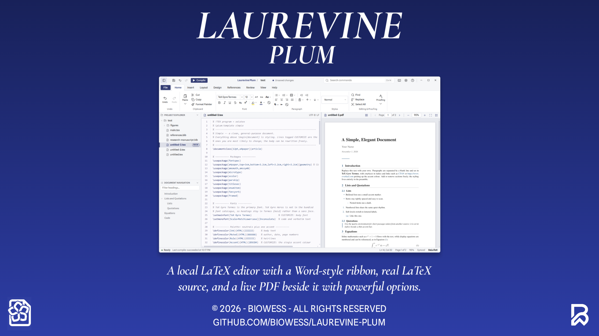
</p>

<h1 align="center">Laurevine Plum</h1>

<p align="center">
  <strong>A local LaTeX editor with a Word-style ribbon, real LaTeX source, and a live PDF beside it.</strong>
</p>

<p align="center">
  Laurevine Plum (Plum for short) is a desktop editor for people who need the output quality of LaTeX but want the familiarity of a ribbon-driven word processor. Every ribbon button, dialog and gallery writes ordinary LaTeX into your source file, so nothing is hidden and nothing locks you in. Compilation runs on your own machine with your own TeX distribution, and the resulting PDF appears next to the source.
</p>


<p align="center">
  
  
  
  
  
  
  
  
</p>

---

## Table of Contents

- [Overview](#overview)
- [Features](#features)
  - [Workspace and source editing](#workspace-and-source-editing)
  - [The ribbon](#the-ribbon)
  - [Projects, files and the main document](#projects-files-and-the-main-document)
  - [Compilation and PDF preview](#compilation-and-pdf-preview)
  - [Page layout and document design](#page-layout-and-document-design)
  - [Tables](#tables)
  - [Equations and symbols](#equations-and-symbols)
  - [Pictures and figures](#pictures-and-figures)
  - [Charts](#charts)
  - [Flow diagrams and TikZ](#flow-diagrams-and-tikz)
  - [Citations, bibliography and cross-references](#citations-bibliography-and-cross-references)
  - [Review tools](#review-tools)
  - [Fonts and typography](#fonts-and-typography)
  - [Preferences and keyboard shortcuts](#preferences-and-keyboard-shortcuts)
  - [Built-in help](#built-in-help)
  - [Safety and recovery](#safety-and-recovery)
- [Theme Showcase](#theme-showcase)
- [Getting Started](#getting-started)
  - [Requirements](#requirements)
  - [Installation](#installation)
  - [First launch and LaTeX setup](#first-launch-and-latex-setup)
  - [Your first document](#your-first-document)
- [Usage Guides](#usage-guides)
  - [Choosing the compiler for a document](#choosing-the-compiler-for-a-document)
  - [Building a diagram and inserting it as TikZ](#building-a-diagram-and-inserting-it-as-tikz)
  - [Plotting data with the chart editor](#plotting-data-with-the-chart-editor)
  - [Editing an existing table](#editing-an-existing-table)
  - [Citing sources](#citing-sources)
  - [Restyling a whole document](#restyling-a-whole-document)
  - [Exporting your work](#exporting-your-work)
- [Templates and Document Creation](#templates-and-document-creation)
- [Architecture and Technology Stack](#architecture-and-technology-stack)
- [Project Structure](#project-structure)
- [Troubleshooting](#troubleshooting)
- [Known Limitations and Roadmap](#known-limitations-and-roadmap)
- [License and Acknowledgements](#license-and-acknowledgements)
- [Contributing and Support](#contributing-and-support)
- [Closing Note](#closing-note)

---

## Overview

Plum is a single-window desktop application built on Electron. The window is divided into a ribbon across the top, a sidebar with a project explorer and document outline, a **source pane** that holds plain LaTeX, and a **PDF pane** that shows the compiled result. The ribbon has eight tabs (Home, Insert, Layout, Design, References, Review, View, Help) that follow the structure of a conventional word processor.

The central idea is that the ribbon is an authoring aid and not a replacement for the source. Selecting text and pressing **Bold** wraps it in `\textbf{...}`. Choosing a heading from the Styles gallery writes `\section{...}`. Packages are added to the preamble once, automatically, when a feature needs them. What you end up with is a normal `.tex` project that any other editor or build system can open.

**Who it is for.** Students writing coursework and theses, researchers preparing manuscripts, engineers writing reports, and LaTeX users who want visual tools for tables, equations, figures and diagrams without leaving the source.

**What it handles.**

- Single-file documents and multi-file projects opened from a folder, with a selectable main document.
- Articles, reports, books, letters, lab reports, homework sets, and double-spaced journal manuscripts, through a built-in template catalogue.
- Documents typeset with XeLaTeX, LuaLaTeX or pdfLaTeX, chosen per file.
- Bibliographies through BibTeX or Biber, with a citation library and importers for `.bib`, CSL JSON and RIS.

**Distinctive characteristics.**

- A visual **flow diagram editor** that generates TikZ code.
- A **chart editor** with a spreadsheet grid and live preview, backed by Matplotlib, that saves figures and a re-editable sidecar file.
- A visual **table editor** with merged cells that can reopen existing `tabular`, `table` and `longtable` code.
- A data-driven **ribbon** with a fuzzy **command palette** (Ctrl/Cmd + K) that finds and runs any ribbon button.
- A guided **first-run setup** that detects, verifies and, where needed, explains how to install a TeX distribution.
- **Everything local.** Documents are compiled and stored on your computer. The only outgoing request the application makes on its own is a once-per-launch release check (see [Architecture](#architecture-and-technology-stack)).

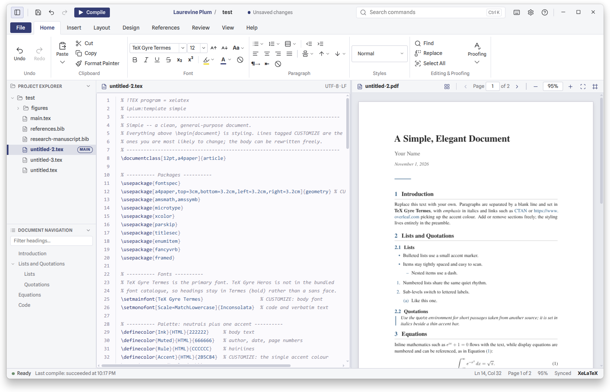

---

## Features

### Workspace and source editing

The source pane is a LaTeX editor with syntax colouring, optional line numbers, and a gutter that carries compile-error markers and comment markers. It uses a windowed renderer, so long files stay responsive. Undo and redo are tracked per file (up to 500 entries) and cover typing as well as ribbon actions, dialog insertions and Replace All, each as a single step.

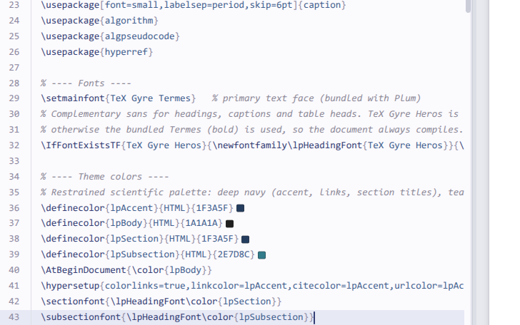

**Document navigation.** The sidebar outline lists headings from `\part` down to `\subparagraph`, skipping comments and verbatim-like environments. It follows the caret, expands collapsed ancestors as you move, jumps to a heading when you click it, and has a filter box.

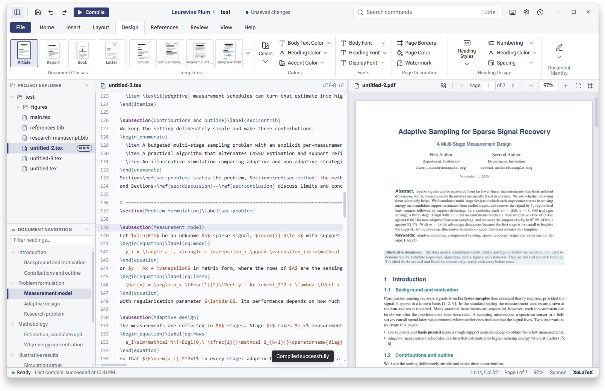

**Command palette.** Ctrl/Cmd + K opens a fuzzy-ranked search across ribbon commands, File actions and project files, with shortcut hints. Choosing a ribbon result switches to its tab and runs the real button.

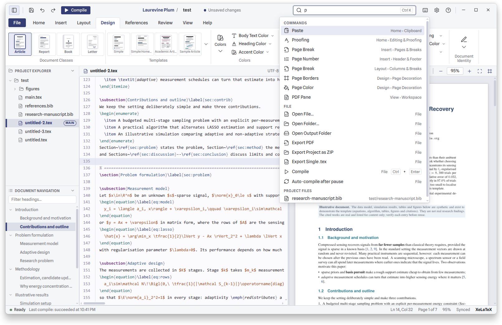

**Find and Replace.** A compact panel anchored to the source pane (Ctrl/Cmd + F or H) supports case-sensitive, whole-word and regular-expression modes, highlights every match, shows an "n of m" counter, can limit replacement to the selection, and accepts `$1` and `$&` in regex mode. Replace All is one undo step.

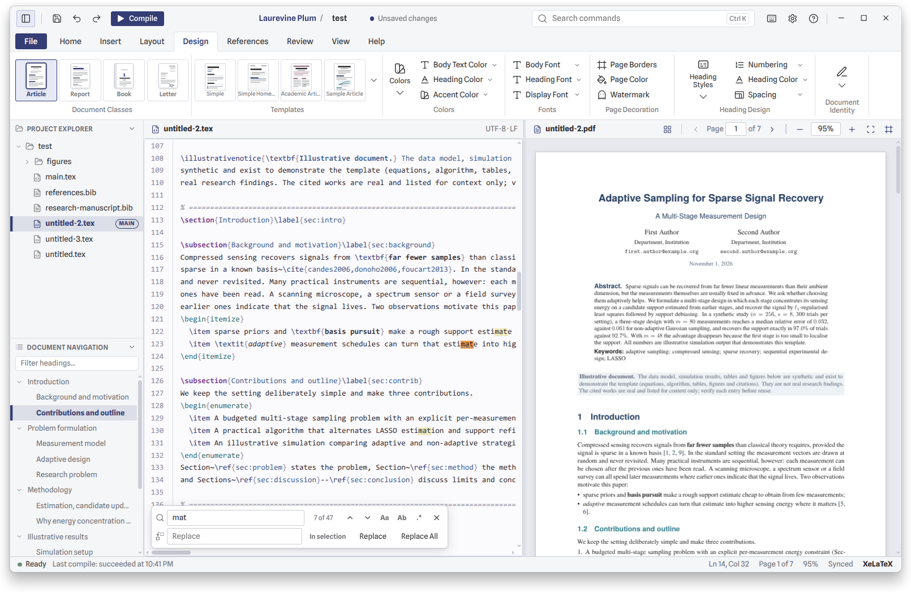

### The ribbon

The ribbon is defined as data, so each control either edits LaTeX, opens a dialog, or changes the view. The Home tab covers the day-to-day formatting work.

| Tab | Main groups | Representative actions |
| --- | --- | --- |
| **Home** | Undo, Clipboard, Font, Paragraph, Styles, Editing and Proofing | Bold, italic, underline, strikethrough, sub/superscript, font colour, highlight, font and size, change case, Format Painter, lists, alignment, indents, line spacing, find, replace |
| **Insert** | Breaks, Links, Footnotes, Comments, Tables, Illustrations, Contents, Header and Footer, Equations, Symbols, Charts and Diagrams | Page and column breaks, hyperlinks, table editor, picture and figure, equation editor, symbol picker, chart, flow diagram |
| **Layout** | Page Setup, Columns and Breaks, Paragraph, Pagination, Source Display | Margins, orientation, paper size, columns, numeric indents and spacing, keep-with-next, widow and orphan control |
| **Design** | Document Classes, Templates, Colors, Fonts, Page Decoration, Heading Design, Document Identity | Class gallery, template gallery, colour roles, font roles, borders, page colour, watermark, heading styles, title block, reset to template |
| **References** | Table of Contents, Lists, Footnotes, Citations, Bibliography, Cross-references | Contents and depth, lists of figures and tables, citation picker, source manager, importer, bibliography style, labels |
| **Review** | Proofing, Comments, Changes, Comparison | Spelling, language, word count, comments, track changes, compare |
| **View** | Workspace, PDF View, Zoom, Show, Appearance | Pane toggles, stacked panes, PDF modes, thumbnails, ruler, line numbers, light and dark mode |
| **Help** | Learn, Reference, Support, About | Documentation, getting started, LaTeX basics, package reference, shortcuts, troubleshooting, diagnostics, LaTeX setup |

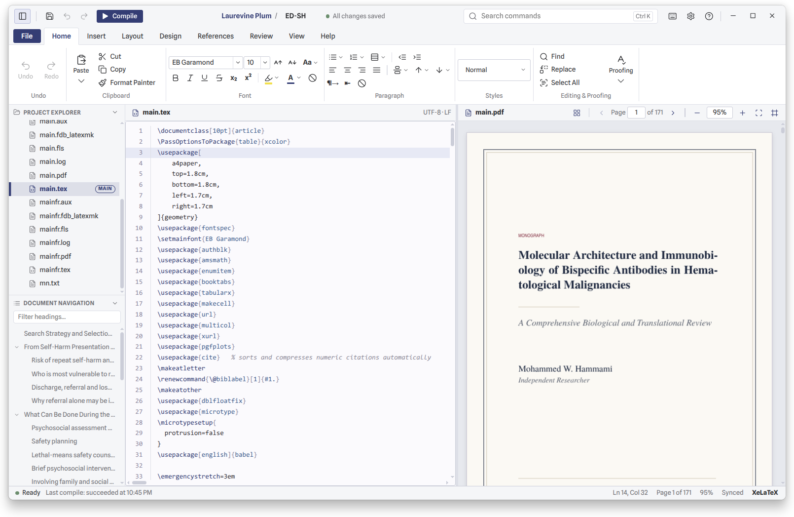

The **Styles gallery** applies Normal, Title, Subtitle, Chapter, Section, Subsection, Subsubsection, Paragraph, Quote or Code, each with a typographically distinct preview.

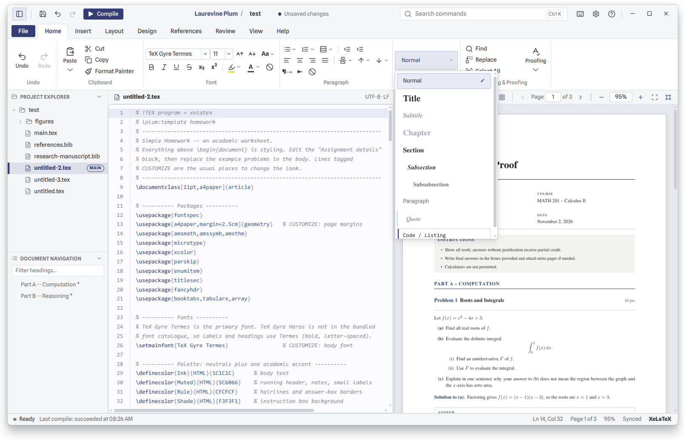

Many controls act on the current selection or on the paragraph at the cursor. Paragraph-level commands are tagged with a trailing `%lp` comment so Plum can find and adjust them later. Leave those comments in place if you want that to keep working.

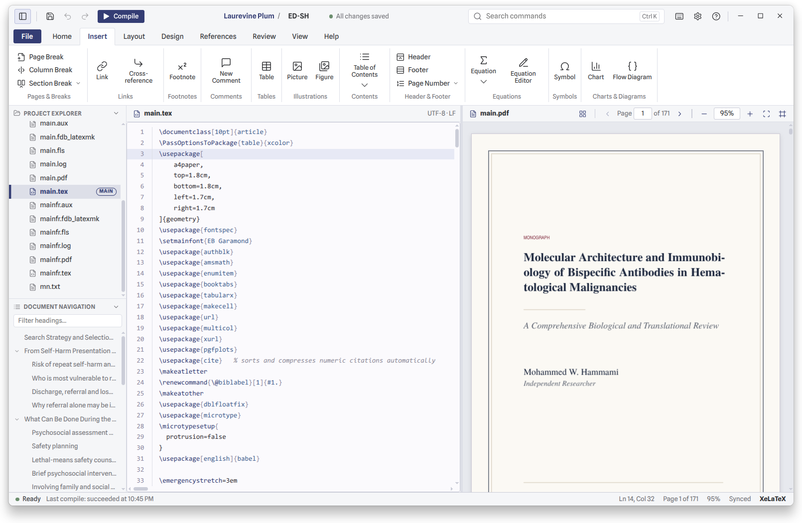

### Projects, files and the main document

Plum starts on a **Welcome panel** offering a new document, an existing folder, up to five recent projects, and a new document from a template.

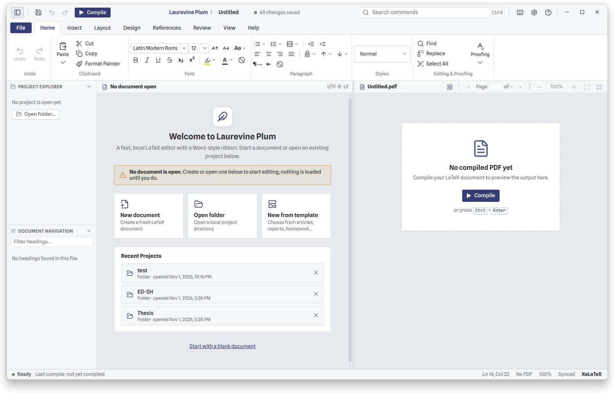

Opening a folder shows a lazy-loading **Project Explorer** (hidden entries beginning with a dot are skipped). Text files such as `.tex`, `.bib`, `.sty`, `.cls`, `.bst`, `.txt` and `.md` open in the editor. The explorer context menu offers Open, Rename, Duplicate, Delete and **Set as main file**. Renames and deletions made outside Plum are detected and the tree refreshes.


**Main document selection.** Compile builds the project's main file. If a folder contains several files with `\documentclass`, Plum scans for them and asks which one is the main file, remembers the choice per folder, and marks that file with a badge in the explorer. You can change it at any time.

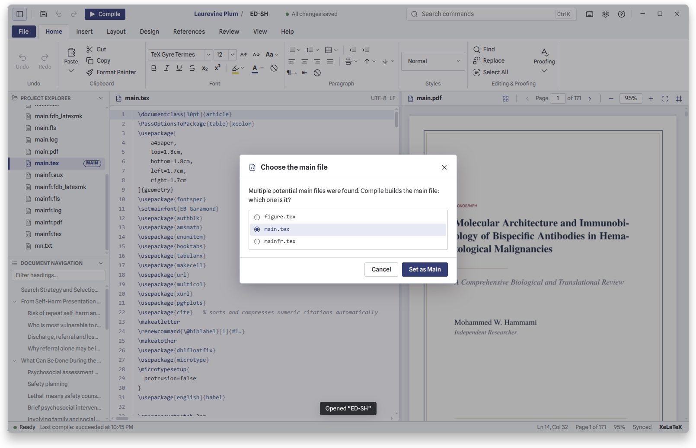

**Save, Save As and Properties.** Save (Ctrl/Cmd + S) writes to disk and Save As (Ctrl/Cmd + Shift + S) saves a copy. Actions that would replace the current document go through a Save, Don't Save or Cancel prompt. The File menu (Backstage) also has a Properties page for the document's title, author, subject, keywords, publisher and language.

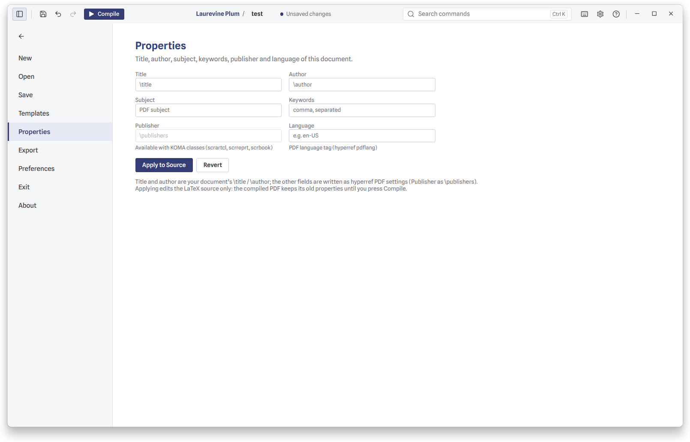

### Compilation and PDF preview

Press **Compile** (Ctrl/Cmd + Enter). Plum sends the project to its built-in local server, which copies the sources into a private temporary job folder, runs the TeX engine there, and streams the PDF back into the preview.

- **Engines.** XeLaTeX, LuaLaTeX and pdfLaTeX are supported. The engine is taken from a `% !TEX program = ...` comment, falling back to the default compiler in Preferences.
- **Multiple passes.** The server reruns the engine until references and the table of contents settle, up to four passes.
- **Bibliographies.** BibTeX or Biber is detected from your document and run by **References, Update Bibliography**.
- **Safety.** Shell escape is disabled, so packages that require it (such as `minted`) do not work. Use `listings` instead.
- **Cancel and stale state.** A Cancel button stops a running build. After you edit the source, the preview shows an **Out of date** badge.
- **Auto-compile.** An optional setting rebuilds about two seconds after you stop typing. A separate option compiles on save.

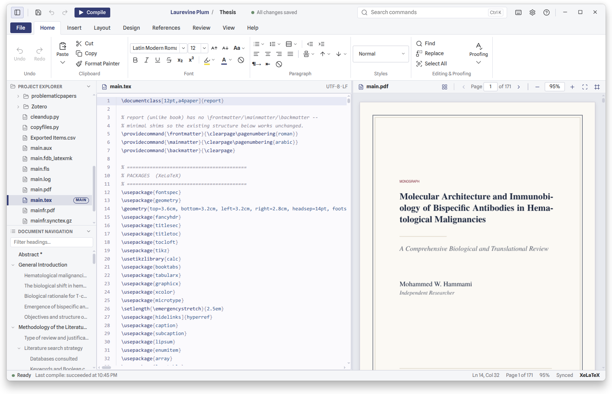

The **PDF viewer** is based on PDF.js and offers zoom in and out, fit page, fit width, page navigation, a page thumbnails sidebar, and three view modes (PDF View, Print Layout, Reading View). Ctrl/Cmd + scroll or a trackpad pinch zooms. Scroll position and zoom are preserved across recompiles. The editor and PDF can sit side by side or stacked, and either pane can be hidden.

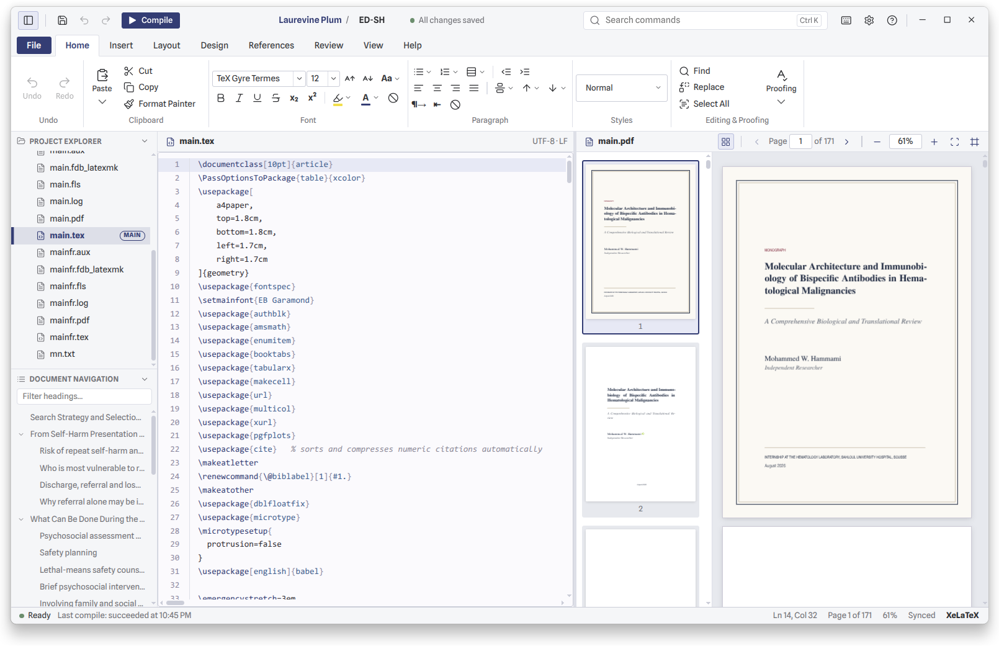

**Error feedback.** When a build fails, the preview pane shows the compiler log and the **Problems panel** opens. It parses the log into errors, warnings and overfull boxes, with filter toggles and a count badge in the status bar. Clicking a row jumps to that file and line, opening other files of the project when necessary, and gutter markers flag the affected lines. A successful compile clears the panel.

**Compilation Diagnostics** (Help menu) shows the details of the last compile run.

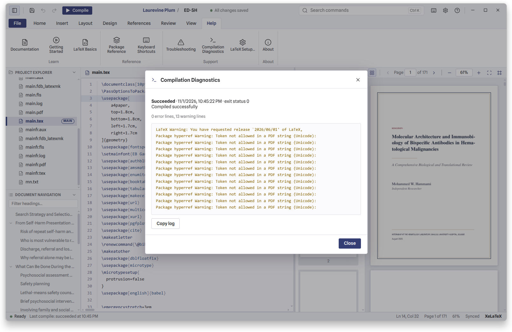

**Export.** From File, Export you can save the compiled PDF (reusing a fresh compile or building one), a project ZIP containing sources, bibliography, figures and assets without build files, or the active file as a single `.tex`. ZIPs are also written to `~/Laurevine Plum Exports` by default, and **Open Output Folder** reveals it.

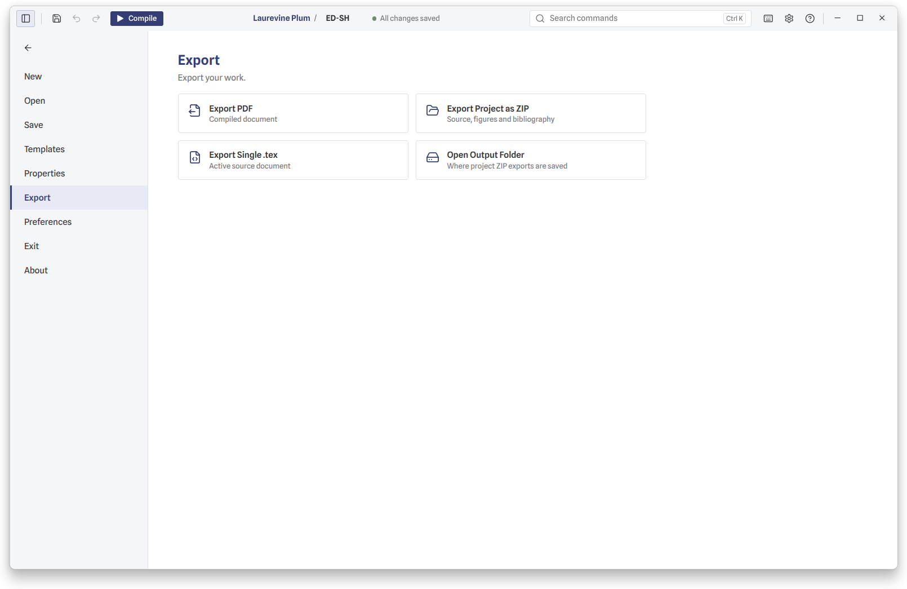

### Page layout and document design

The **Layout** tab manages page setup (margins with Normal, Narrow, Wide and custom presets; portrait or landscape; A4, Letter, Legal, A5), columns (one to three), numeric paragraph indents and spacing, and pagination controls such as keep-with-next, keep-together and widow and orphan control.

The **Design** tab changes the document as a whole:

- **Document Classes** gallery (article, report, book, letter) and **Templates** gallery.
- **Colors**: theme colours and separate body, heading and accent colour roles, written as `\definecolor` entries in the preamble.
- **Fonts**: body, heading and display font roles.
- **Heading Design**: heading styles, numbering depth, colour and spacing, with a Customize dialog.
- **Page Decoration**: one dialog for page borders, page colour and watermark.
- **Document Identity**: a title block dialog for title, author and affiliation, and **Reset to Template**.

Design commands adapt to the open document rather than refusing. They handle beamer, letter, standalone, KOMA, memoir, titlesec, ctex and sectsty headings, move a pdfLaTeX document to XeLaTeX when fontspec is required, and continue in the project's main file if you are editing a secondary file. Lines they add end in a `% lplum: ...` comment, and Reset removes them.

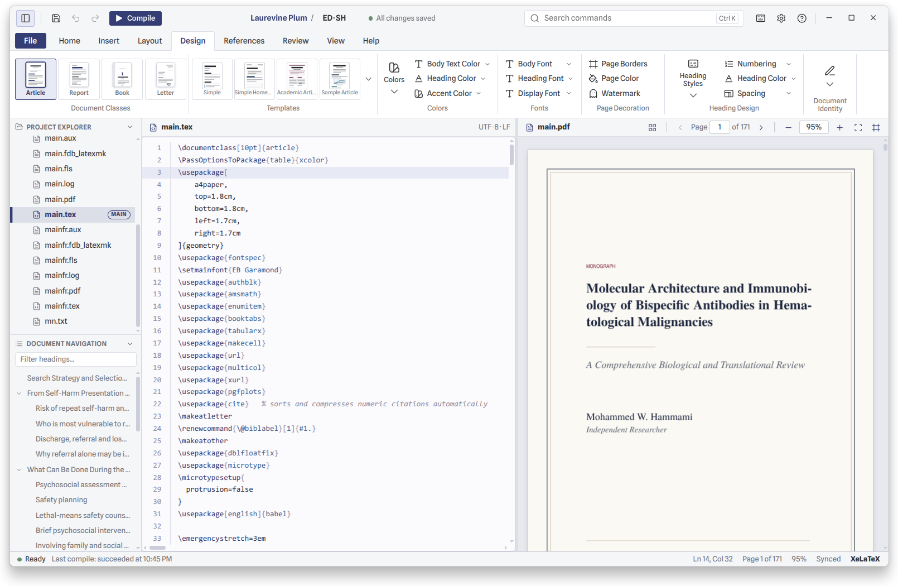

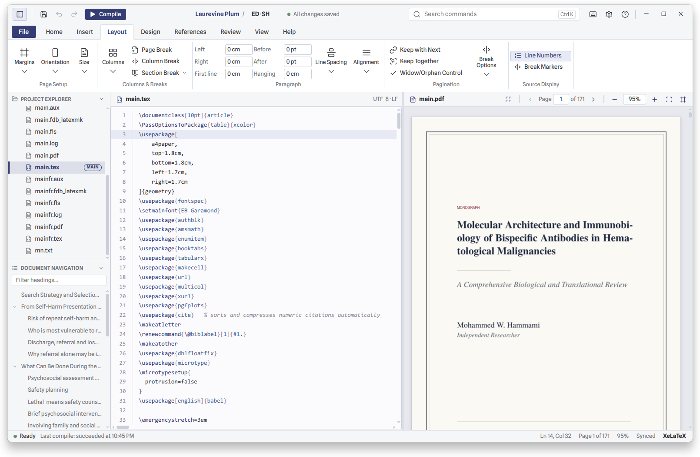

**Page Decoration** offers a background colour with quick tints, borders (solid, dashed, dotted or double, with per-side control, colour, thickness, distance and presets), and a text watermark with font, size, bold and italic, colour, opacity, rotation and position. Backgrounds and borders can be limited to page ranges such as `1, 3-5, 8-`. The live preview and the generated LaTeX come from the same shapes, and the output is a single `eso-pic` layer.

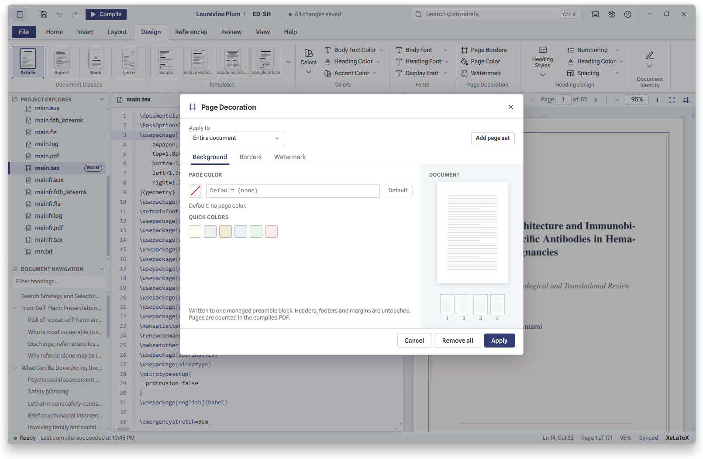

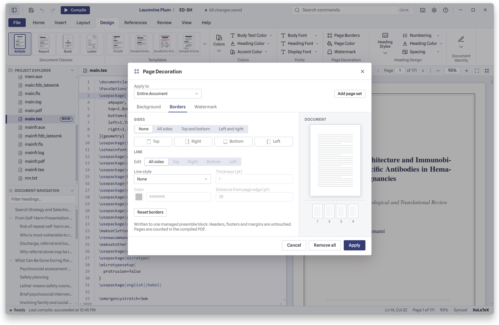

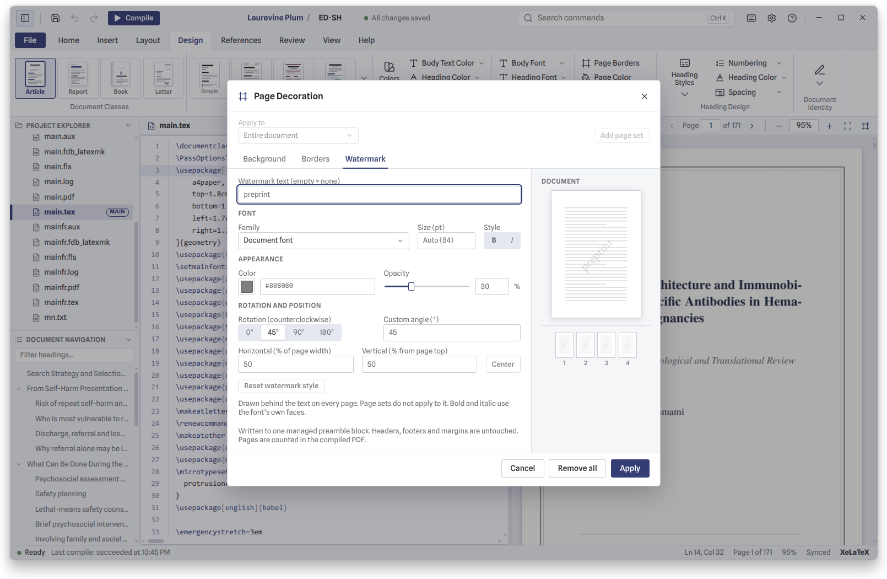

**Heading Design** is a compact dialog for the heading style, numbering, spacing and colour, applied to all headings or to a single level through `titlesec`.

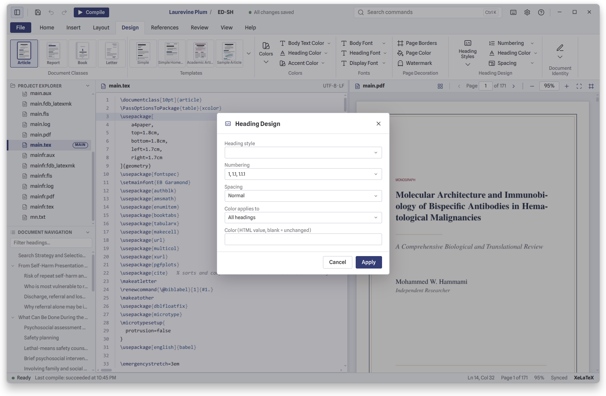

### Tables

**Insert, Table** opens a spreadsheet-style editor with a live preview.

- Select ranges by dragging or with Shift and the arrow keys, and resize the selection with its corner handle.
- Merge cells (written as `\multicolumn` and `\multirow`), set per-column alignment, apply cell colour, and format text.
- Choose a border style: horizontal rules, Booktabs, full grid or none. Booktabs adds the package once.
- Toggle a header row, long table (`longtable`), caption, label and float placement.
- Selected tab-separated text converts into a table.
- When the cursor sits inside an existing `table`, `tabular` or `longtable`, the dialog reopens as **Edit Table**. Plum refuses to open tables it could not write back losslessly rather than risk damaging them.

The editor keeps its own undo history inside the dialog.

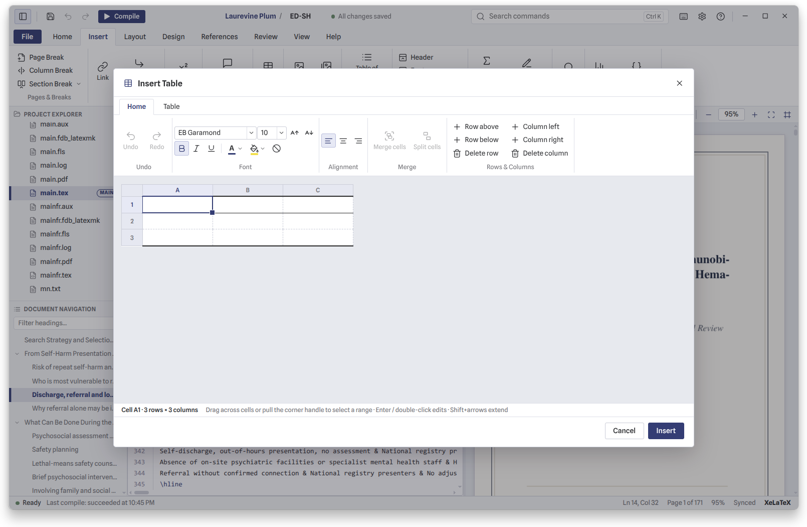

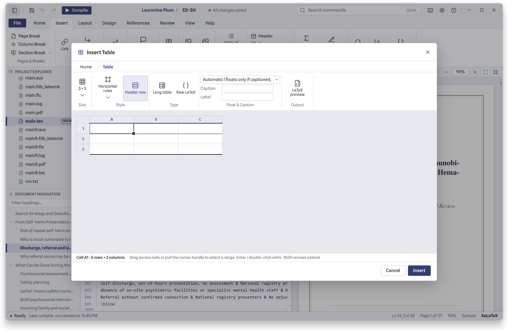

### Equations and symbols

**Insert, Equation** inserts inline `$...$`, display `\[...\]` or an `align` block directly. The **Equation Editor** is a dialog with Inline, Display and Align modes, a source box, a live rendered preview, and a symbol keyboard organised into fifteen categories: Fractions, Scripts, Brackets, Sums and Integrals, Limits, Operators, Relations, Arrows, Greek, Sets and Logic, Number Sets, Functions, Geometry, Misc and Matrix. Templates contain `▢` placeholders that Tab steps through. The rendered preview uses KaTeX loaded from a CDN, so offline it falls back to showing the raw source.

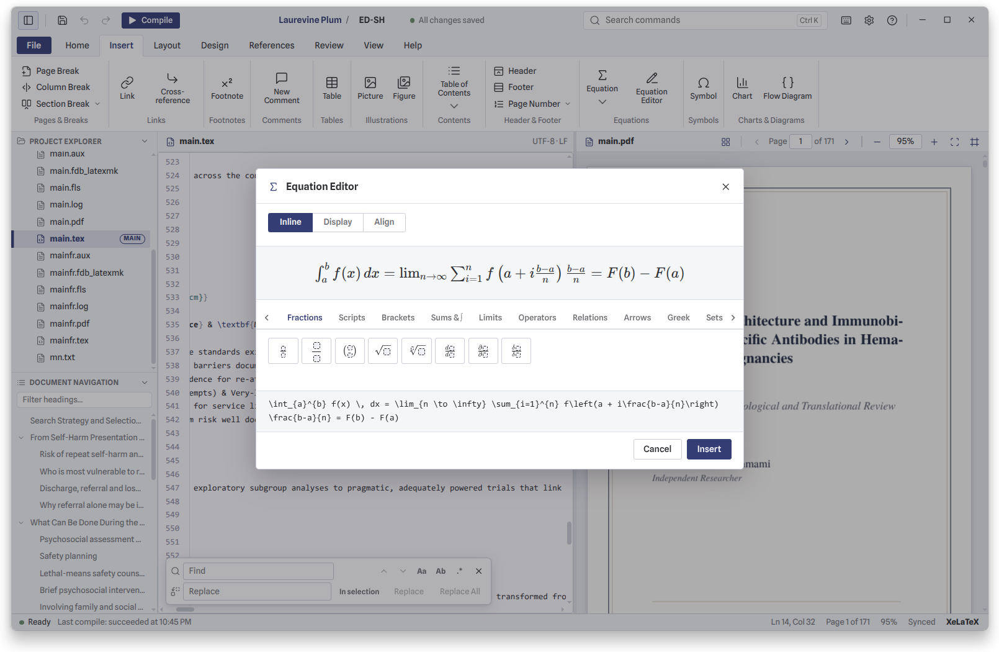

The **Symbol** dialog draws on a curated catalogue and a Unicode database, with a category list, a search box and a preview of the selected symbol. In running text it inserts the Unicode glyph, which suits XeLaTeX and LuaLaTeX. Inside math it inserts the real command (`\alpha`, `\leq`, `\mathbb{R}` and so on) and adds `amssymb` or `amsmath` once. Symbols that have no math command are refused instead of being inserted incorrectly.

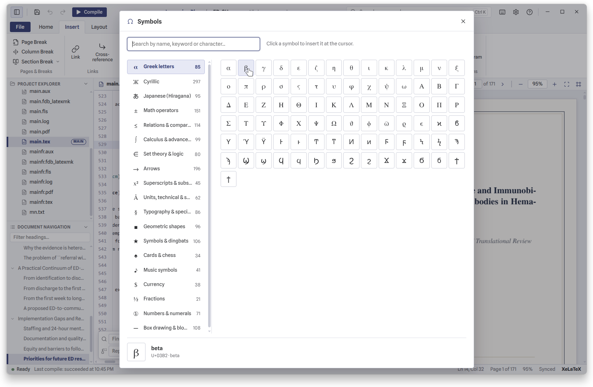

### Pictures and figures

**Picture** inserts `\includegraphics` and **Figure** wraps it in a `figure` environment with caption, label and a placement choice (automatic, here, top, bottom, or a separate page). Importing verifies PNG, JPEG or PDF files by their file signature, rejects empty files and files over 25 MB, copies them into the project's `figures/` folder, and reuses an identical file that is already there. A project folder must be open to copy files into it.

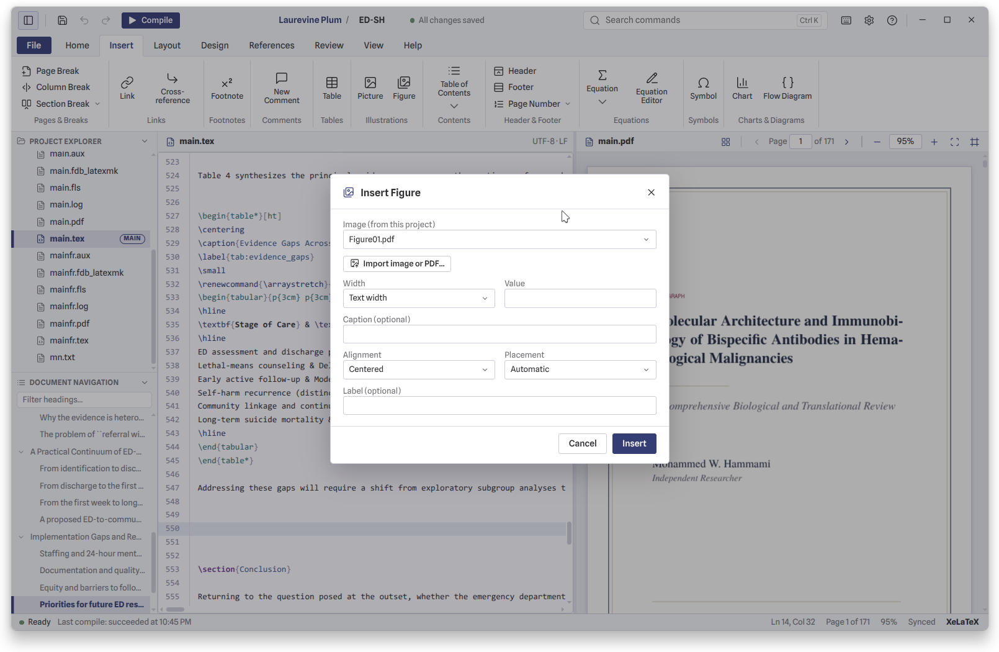

### Charts

**Insert, Chart** draws six chart types (line, scatter, bar, histogram, box and heatmap) from a spreadsheet grid of up to 250 rows by 12 columns. Plots are rendered by a bundled Python script using Matplotlib, so this feature needs Python 3 with Matplotlib installed on your computer. Nothing else in Plum needs Python.

- **Tabs.** Preview, Spreadsheet, Code and Export. The Code tab shows the equivalent standalone Python script, or an editable configuration that drives the chart.
- **Data.** CSV import detects the delimiter (comma, semicolon, tab or pipe), honours quoted fields, converts decimal commas, and detects header rows.
- **Variants.** Step lines; linear fit, linear fit with 95% band, or quadratic fit for scatter; stacked bars; density curve for histograms; notched boxes; value labels on heatmaps.
- **Appearance.** Colour palettes (colour-blind safe, Viridis, greyscale), plot styles, axis ranges, log scales, grid, legend, fonts, sizes, aspect ratio presets, and a **Publication Style** preset (8 pt text, open axes, no grid, 3.4 inch width).
- **Output.** PNG, SVG or PDF, saved as `figures/<name>.<ext>` with a `<name>.chart.json` sidecar. Place the cursor on such a figure and the dialog reopens with its data and an **Update in document** action.

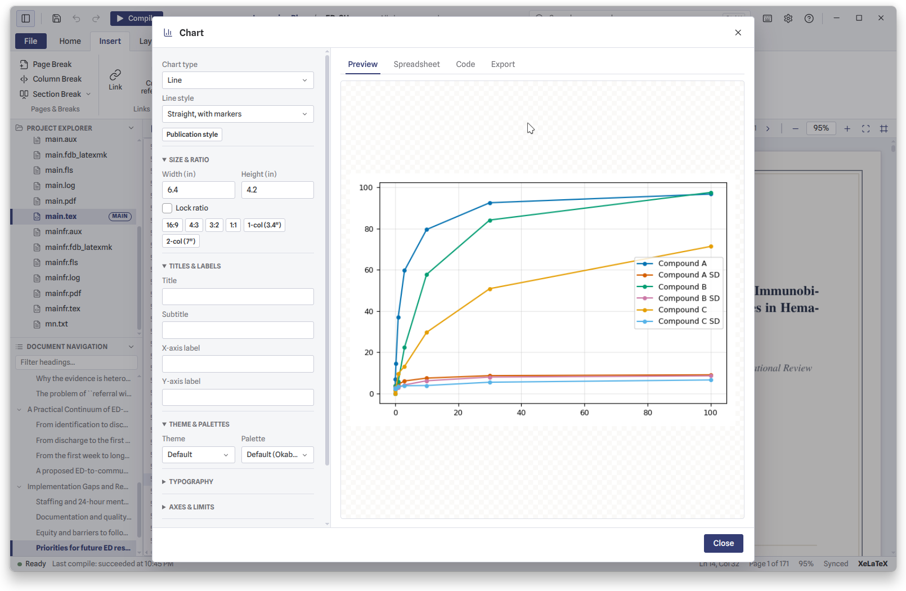

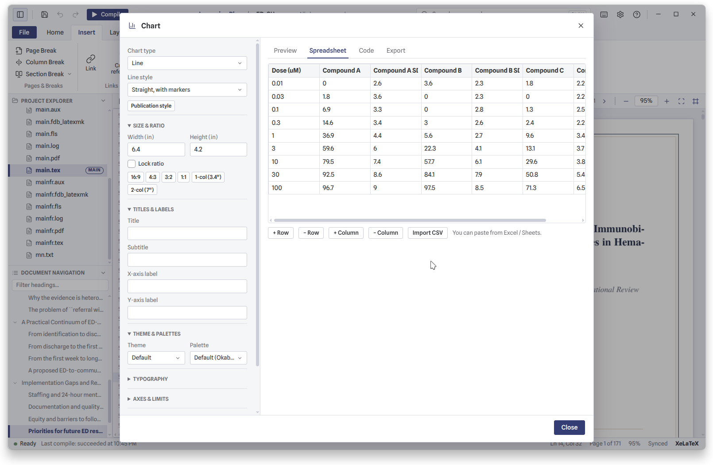

### Flow diagrams and TikZ

**Insert, Flow Diagram** opens a visual editor on an SVG canvas that exports **TikZ**.

- **Shapes.** Basic: rectangle, rounded rectangle, ellipse, triangle, callout and text annotation. Flowchart: terminator, decision, input and output, predefined process, document, manual input, preparation and database.
- **Connectors.** Straight or elbow routing, arrowheads at the end, start, both or neither, solid, dashed or dotted lines, colour, thickness, and text labels that export as TikZ nodes.
- **Styling.** Fill, outline, text colour, font family and size, bold and italic, horizontal and vertical alignment, opacity, corner radius and border thickness.
- **Editing.** Eight-handle resize, snap to grid, duplicate (Ctrl+D), delete, bring to front and send to back, multi-step undo and redo (Ctrl+Z, Ctrl+Y), mouse-wheel zoom, background-drag pan, fit to window (Ctrl+1) and reset to 100% (Ctrl+0).
- **Project files.** Diagrams save as `figures/<name>.diagram.json` plus `figures/<name>.tex`, and can be reopened from the explorer or by placing the cursor on the inserted diagram.
- **Export.** A TikZ code panel offers **Copy TikZ** and **Insert into document**. Inserting adds only the TikZ libraries the diagram needs to the preamble (`shapes.geometric`, `arrows.meta`, `positioning`, `calc`, `fit`, `backgrounds`, `matrix`, `patterns`, `shadows`). If you edit the generated code by hand, it is flagged **Manually edited (locked)** until you clear the lock or regenerate it from the canvas.

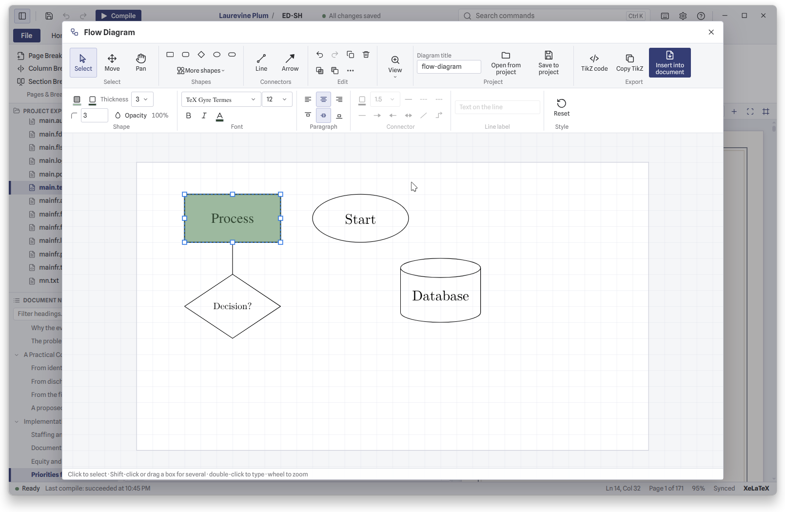

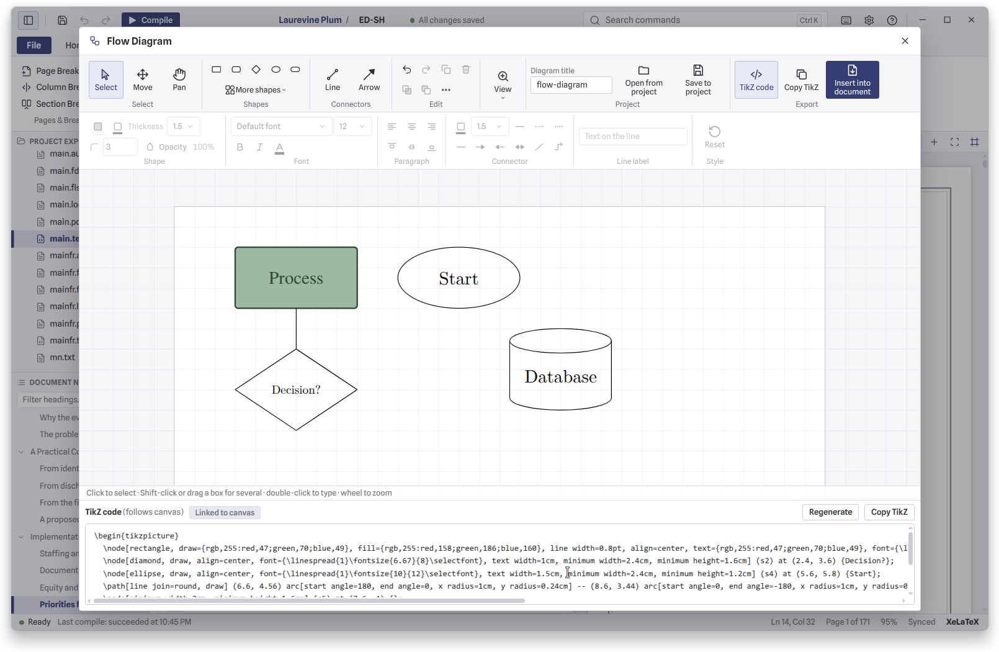

### Citations, bibliography and cross-references

Plum keeps a **Citation Library** that persists between sessions and works alongside the project's `.bib` file.

- **Managing entries.** Required-field validation per entry type, duplicate detection by DOI, key and title, automatic suffixes for duplicate keys, special-character escaping, and an interactive key generator. PDF files can be imported to pull title, author and DOI metadata from them.
- **Importing.** **Import references** accepts `.bib`, CSL JSON and RIS through a file picker, pasted text or drag and drop. A preview table with checkboxes flags duplicates against the project and the library before anything is merged. Files exported from reference managers such as Zotero in these formats can be imported this way. Plum has no direct connection to Zotero.
- **Citing.** **Insert Citation** opens a searchable picker and produces `\cite`, `\citep` or `\textcite` to match natbib or biblatex.
- **Style.** The Style box edits `style=` for biblatex (APA, Vancouver, Chicago, IEEE) or `\bibliographystyle` for BibTeX (`apalike`, `unsrt`, `chicago`, `IEEEtran`).
- **Bibliography.** Insert a bibliography with a chosen heading, and **Update Bibliography** compiles with a real BibTeX or Biber pass. Insertion is idempotent.
- **Feedback.** Parse errors in an edited `.bib` file are highlighted in the gutter and in the status bar.

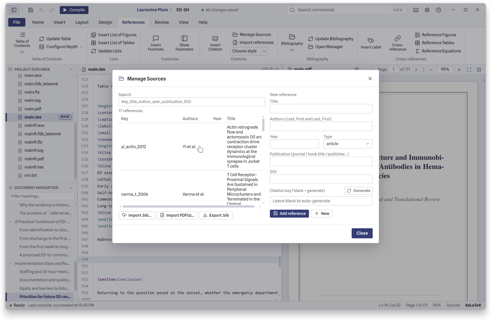

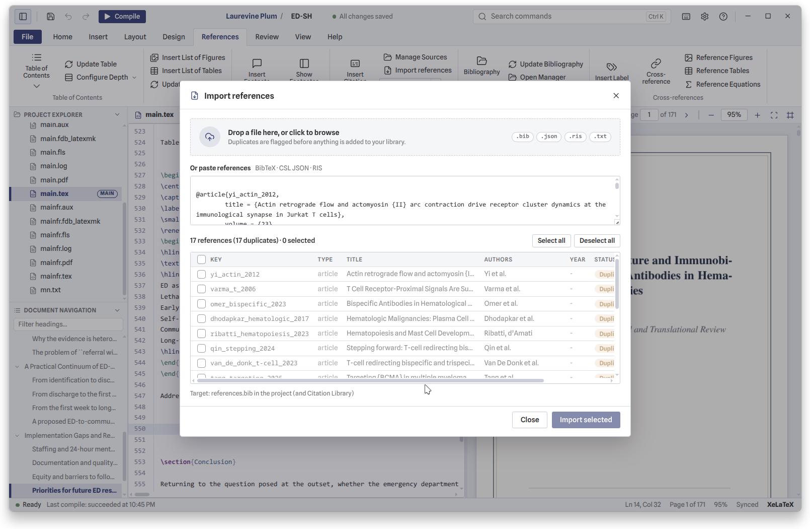


**Cross-references.** Insert Label adds `\label{...}`, and the cross-reference dialogs list targets for `\ref`, `\eqref` and `\autoref`, filterable by all targets, figures, tables or equations. The References tab also covers tables of contents (with depth), lists of figures and tables, and footnotes.

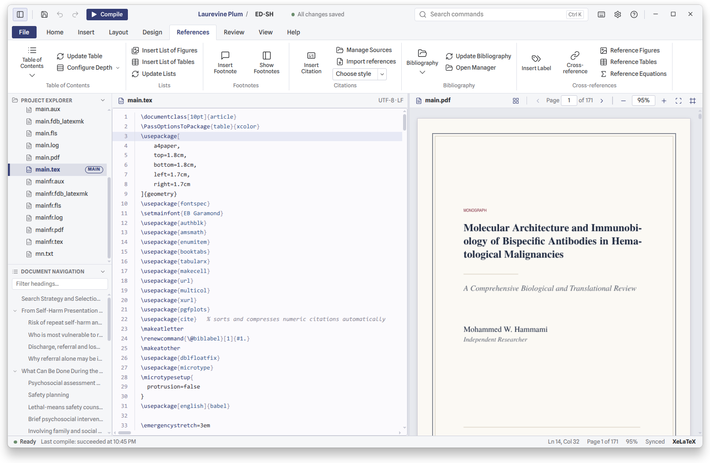

### Review tools

- **Comments** attach to a range of text, can be resolved, reopened and filtered, and show as *Detached* if their text disappears (they re-attach if it returns). Comments are stored in the application's own storage, not inside your `.tex` file.
- **Track Changes** keeps a baseline snapshot of the file and shows word-level changes in a review pane with per-change and bulk Accept and Reject. Display modes are All, Simple and No Markup. Rejecting restores baseline text as a single undo step.
- **Compare** shows a side-by-side diff of the open file against its saved copy or another `.tex` file in the project, with next and previous difference, an Ignore whitespace option, and per-change "Use other side". The other file is never modified.
- **Proofing.** Spelling uses the built-in spellchecker of the application shell. Language sets the editor language and offers the matching `babel` line. **Word Count** reports words, characters with and without spaces and paragraphs, ignoring commands, comments and math, with a selection-only option.

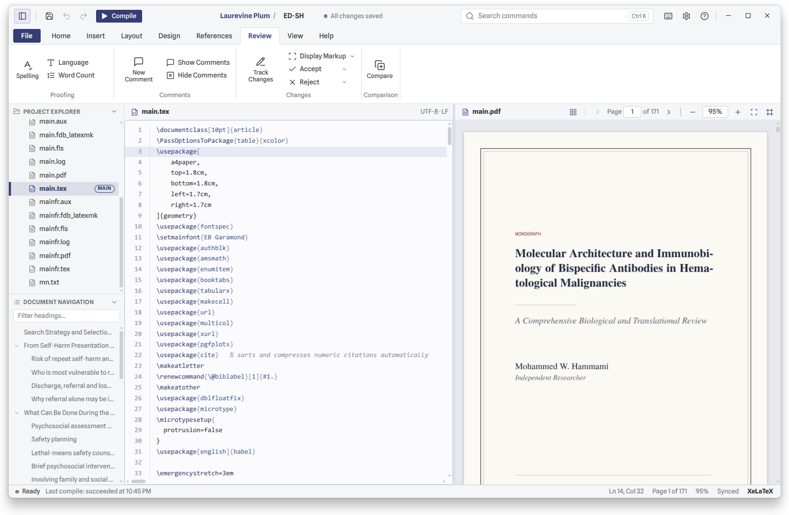

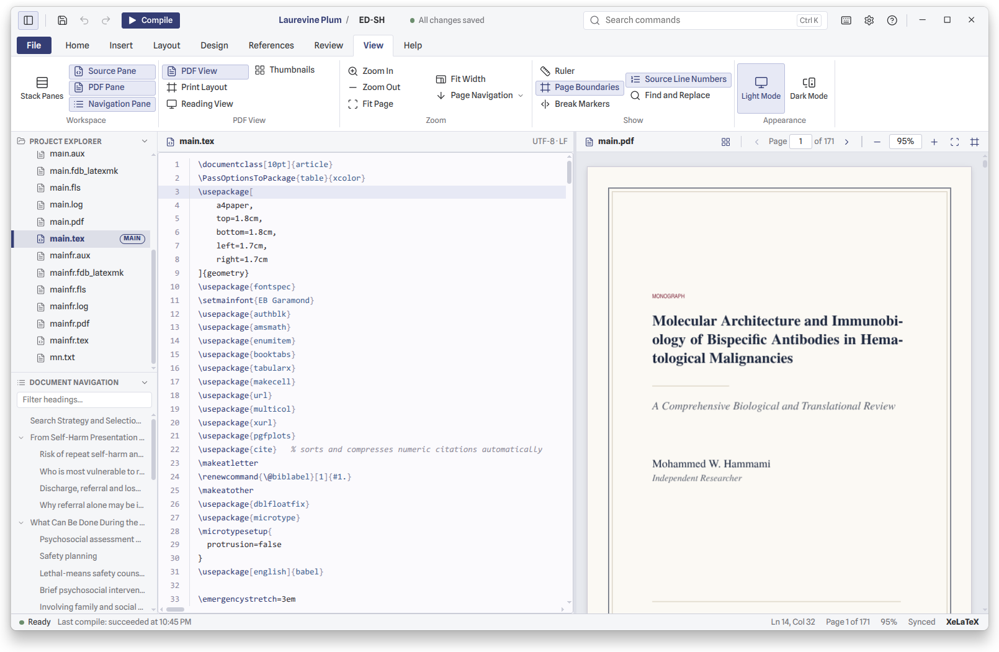

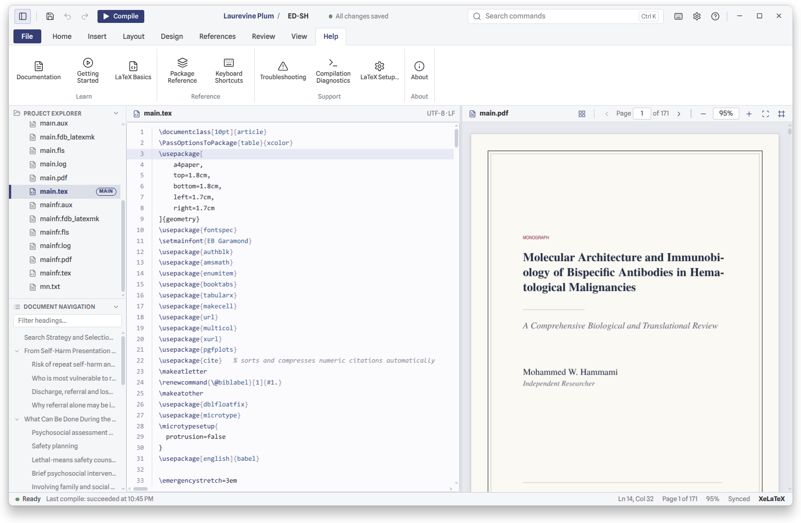

### Fonts and typography

Plum bundles 40 font families under `fonts/` (see [License and Acknowledgements](#license-and-acknowledgements)), including TeX Gyre Termes, Pagella and Heros, EB Garamond, Cormorant Garamond, Libre Baskerville, Lora, Merriweather, Playfair Display, PT Serif, Inter, Roboto, Open Sans, Lato, Poppins, Montserrat, Source Sans 3, Fira Sans, JetBrains Mono, Fira Code, Source Code Pro, OpenDyslexic, and Arabic-script families (Amiri, Cairo, Noto Sans Arabic, Scheherazade New, Tajawal). The compile server exposes these to XeLaTeX and LuaLaTeX, and the ribbon's font box lists the fonts the server can actually use. Choosing a font writes `\setmainfont`, `\newfontfamily` or a scoped `\fontspec` group and adds `fontspec` once. Fonts that are not available give a pre-compile warning.

Design's body, heading and display font roles use the same list, and Preferences can set a default body font for new documents and a separate interface font for the application itself.

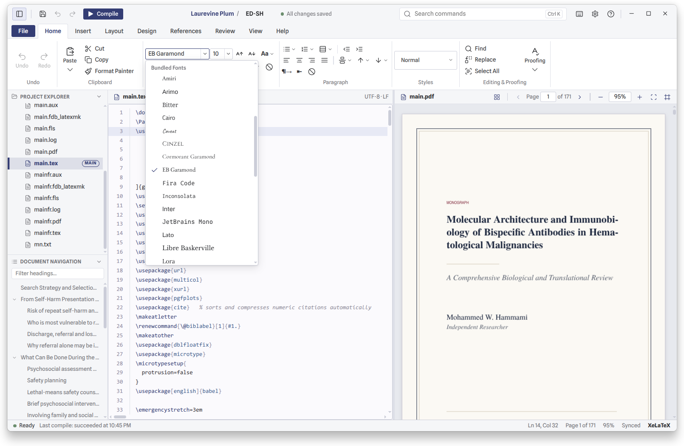

### Preferences and keyboard shortcuts

**File, Preferences** holds settings that apply immediately and persist: light, dark or system colour mode and the interface theme (see [Theme Showcase](#theme-showcase)), editor font size, tab width, line numbers, default compiler (XeLaTeX or LuaLaTeX), default body font, interface font, compile on save, autosave to disk (off by default, every 30 seconds for files with a handle), auto-compile after pause, and the LaTeX setup status with a **Run setup again** button. Defaults apply to new documents only. A document that names its own compiler or `\setmainfont` is never changed.

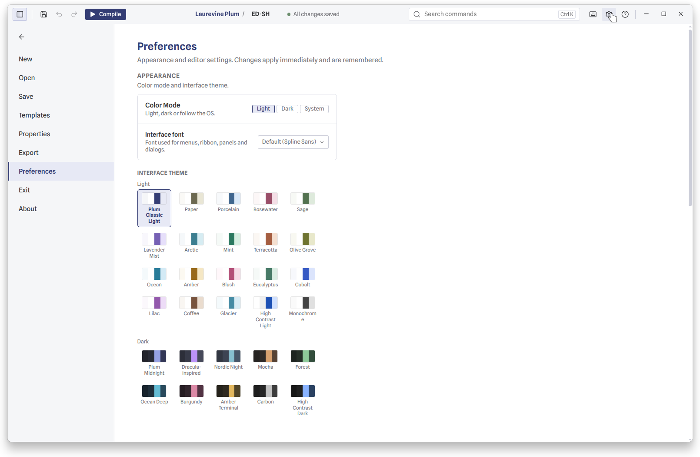

Main shortcuts (Cmd replaces Ctrl on macOS keyboards):

| Action | Shortcut |
| --- | --- |
| Save / Save As | Ctrl + S / Ctrl + Shift + S |
| Compile | Ctrl + Enter |
| Command search | Ctrl + K |
| Find / Replace | Ctrl + F / Ctrl + H |
| Next / previous match | Enter / Shift + Enter, F3 / Shift + F3 |
| Undo / Redo | Ctrl + Z / Ctrl + Y or Ctrl + Shift + Z |
| Close dialog, menu or panel | Esc |
| Add or save a comment | Ctrl + Enter |
| Zoom PDF | Ctrl + scroll or trackpad pinch |

**Help, Keyboard Shortcuts** lists all of them and is searchable.

### Built-in help

The Help tab includes in-app documentation, a Getting Started guide, LaTeX Basics, a searchable **Package Reference** with 101 common packages, searchable **Troubleshooting** with 28 entries, Compilation Diagnostics, and LaTeX Setup. The guides are Markdown files in `docs/`, rendered by a small built-in Markdown renderer.

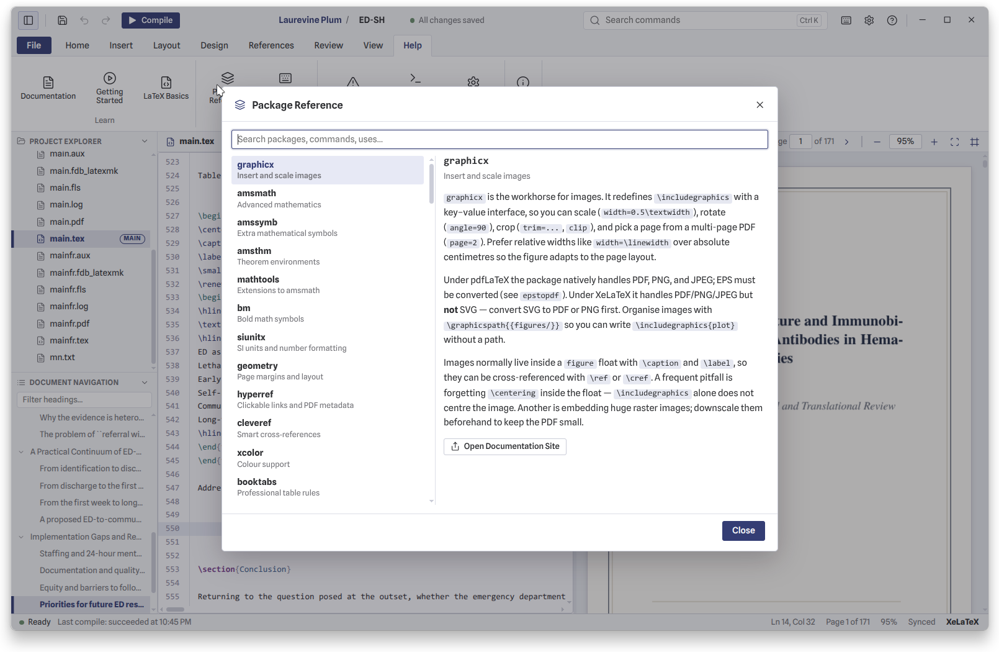

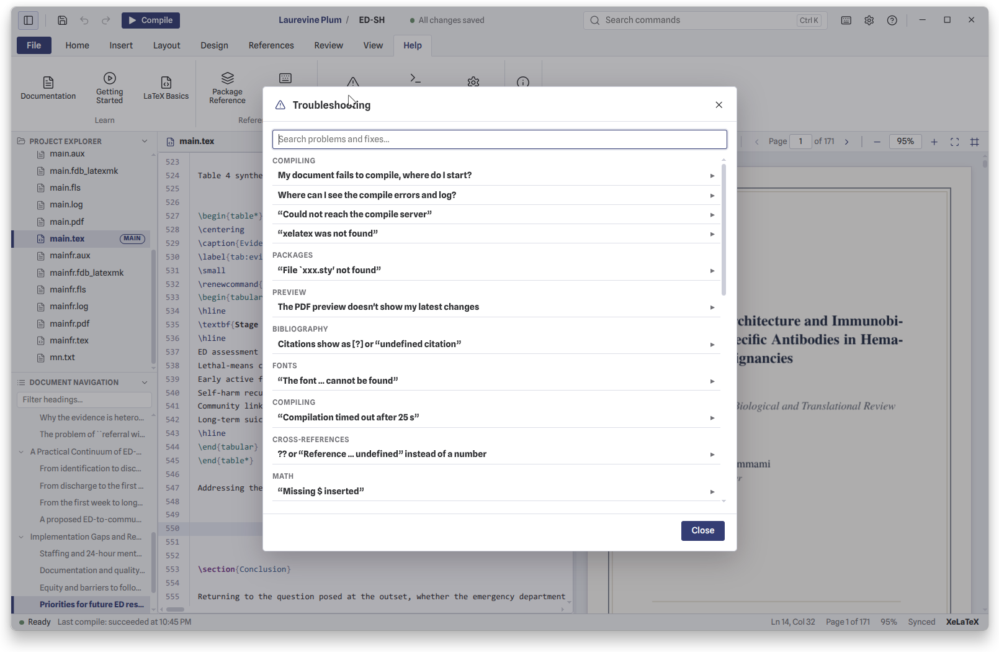

### Safety and recovery

- **Crash recovery.** Drafts are written to browser storage inside the application profile. After a crash you are offered Restore or Discard on next launch. Storage is capped at 20 files and 500 KB per file.
- **Unsaved changes.** Closing or replacing a document with unsaved edits asks first. The window title shows a marker while the document is dirty.
- **Restricted file access.** The in-app file picker can browse your folders by name, but Plum can only read, write, create and delete inside folders and files you have chosen through the application. Those grants are remembered in `~/.laurevine-plum/fs-grants.json`.

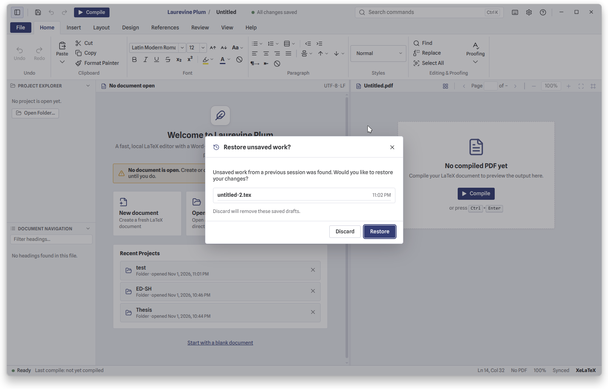

---

## Theme Showcase

Plum ships a library of **30 interface themes**, 20 light and 10 dark. Open **File, Preferences** and use the Interface Theme picker. The Light, Dark and System buttons choose the base mode and return to the default palette. Themes recolour the whole interface, including the ribbon, panes, dialogs and the syntax colours of the source editor. Each screenshot below shows the same window and the same document.


### Light themes

| Theme | Character | Preview |
| --- | --- | --- |
| Plum Classic Light | Default palette: light grey-white surfaces with a deep indigo accent | 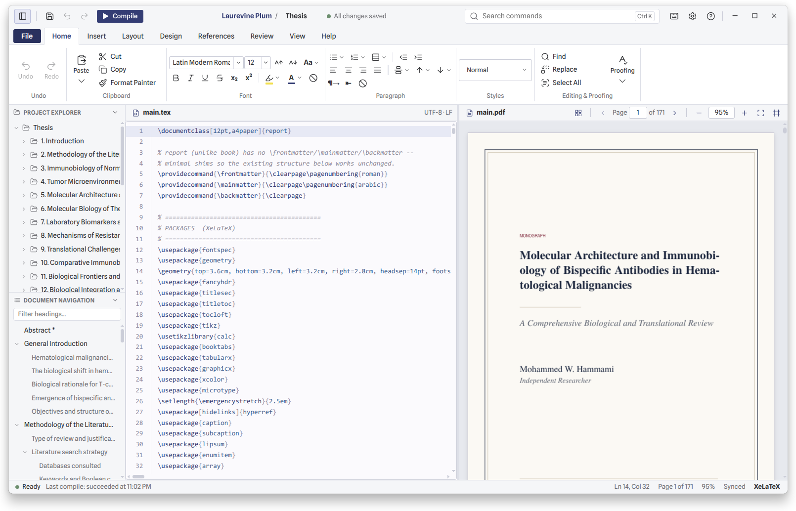 |
| Paper | Warm off-white with an olive-grey accent | 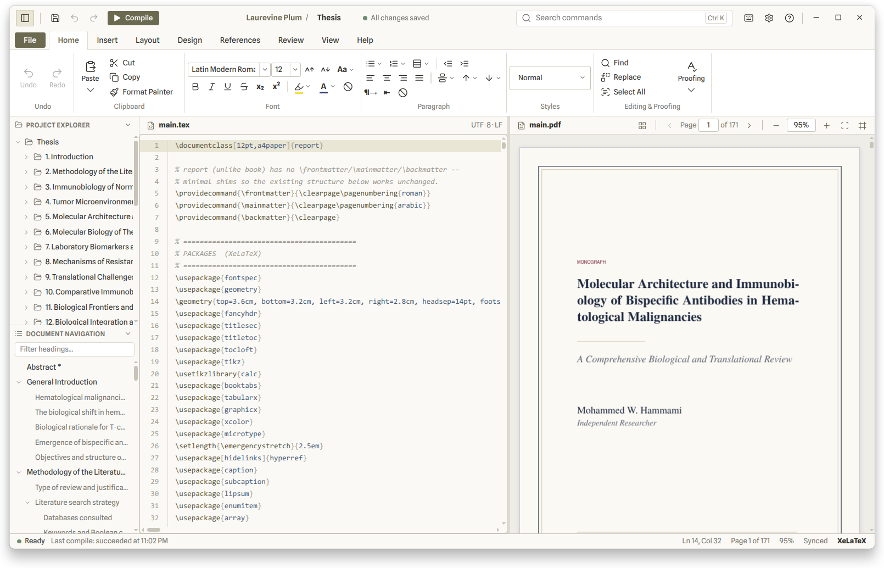 |
| Porcelain | Cool blue-grey whites with a steel-blue accent | 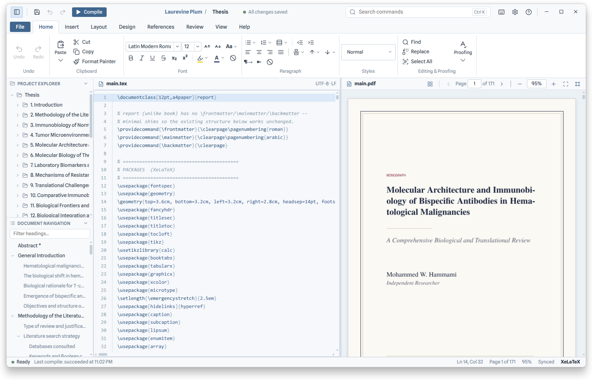 |
| Rosewater | Pale rose-tinted white with a dusty mauve accent | 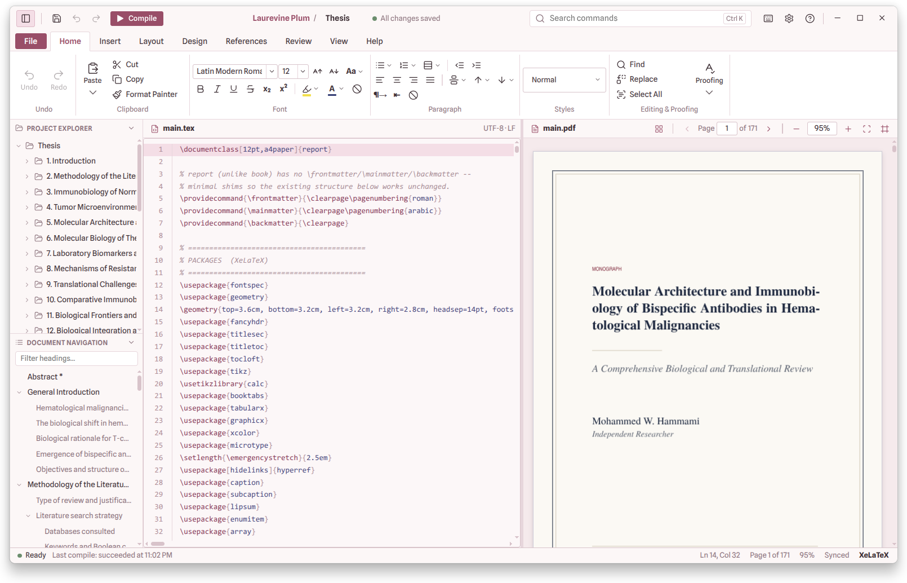 |
| Sage | Pale green-grey with a muted green accent |  |
| Lavender Mist | Pale violet-tinted white with a violet accent | 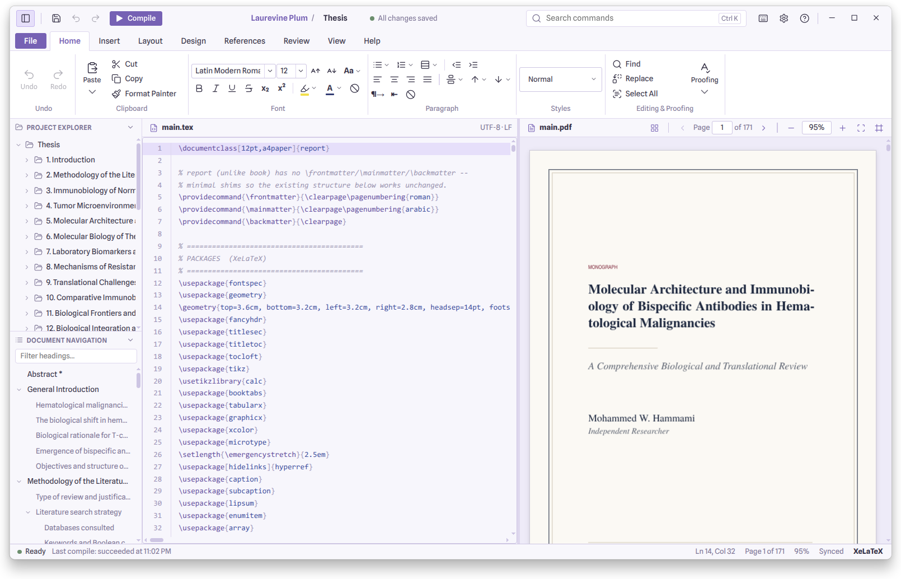 |
| Arctic | Pale blue-grey with a teal-blue accent | 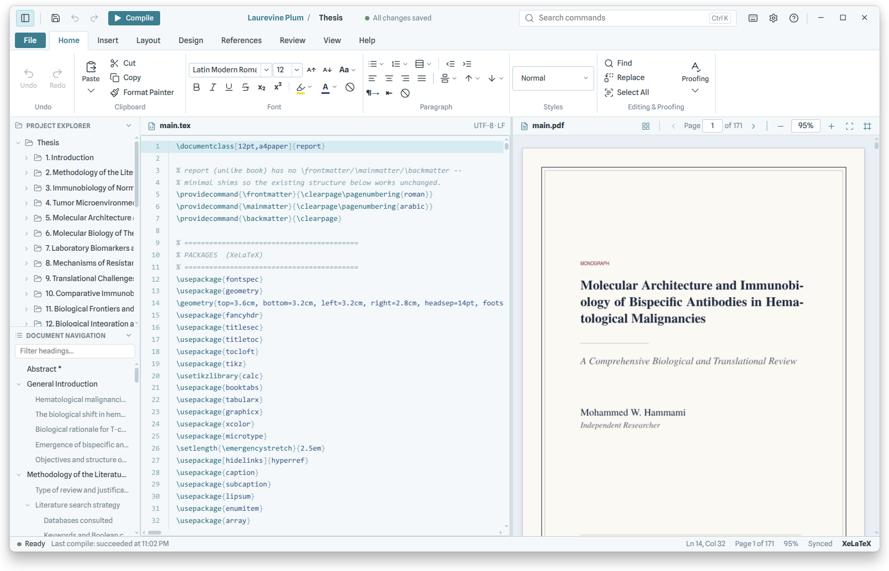 |
| Mint | Pale mint white with a green-teal accent | 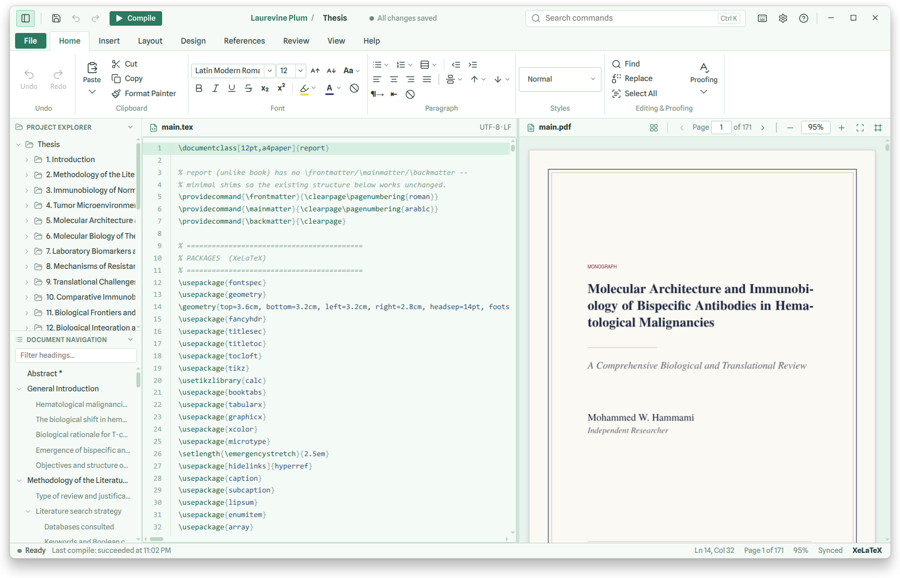 |
| Terracotta | Warm cream with a clay-orange accent | 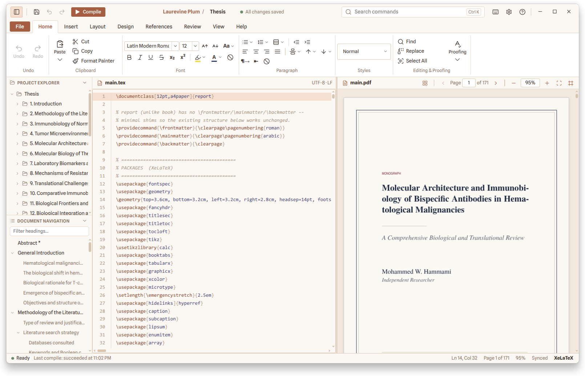 |
| Olive Grove | Soft yellow-green cream with an olive accent |  |
| Ocean | Pale aqua white with a cyan-blue accent |  |
| Amber | Warm cream with an amber-brown accent |  |
| Blush | Pale pink white with a raspberry accent |  |
| Eucalyptus | Pale green-grey with a grey-green accent |  |
| Cobalt | Pale blue-white with a saturated cobalt accent |  |
| Lilac | Pale lilac white with a purple accent |  |
| Coffee | Warm light beige with a brown accent |  |
| Glacier | Pale icy blue with a blue-teal accent |  |
| High Contrast Light | White surfaces with a strong blue accent |  |
| Monochrome | Neutral greys with a dark grey accent |  |

### Dark themes

| Theme | Character | Preview |
| --- | --- | --- |
| Plum Midnight | Dark blue-grey surfaces with a periwinkle accent |  |
| Nightshade | Charcoal-purple surfaces with a purple accent |  |
| Northwind | Slate blue-grey surfaces with an ice-blue accent |  |
| Mocha | Dark brown surfaces with a caramel accent |  |
| Forest | Deep green-black surfaces with a soft green accent |  |
| Ocean Deep | Dark navy-teal surfaces with a cyan accent |  |
| Burgundy | Dark aubergine surfaces with a rose-pink accent |  |
| Amber Terminal | Dark olive-brown surfaces with a gold accent |  |
| Carbon | Neutral dark greys with a light grey accent |  |
| High Contrast Dark | Near-black surfaces with a light blue accent |  |

---

## Getting Started

### Requirements

| Requirement | Needed for | Bundled? |
| --- | --- | --- |
| A TeX distribution that provides `xelatex` (and optionally `lualatex`, `pdflatex`, `bibtex`, `biber`) | Compiling documents | **No.** Install it yourself (TeX Live, MiKTeX, or another distribution) |
| Python 3 with Matplotlib | Only the Insert, Chart feature | **No.** Optional |
| Internet access | Equation Editor preview (KaTeX), icon set refresh, and the once-per-launch release check | Optional. Plum falls back to bundled icons and a plain-text equation preview when offline |
| Electron and Node.js runtime | Running the application | **Yes.** Packaged builds include them |
| PDF.js, interface fonts, document fonts, templates | PDF preview, UI, typesetting | **Yes** |

**Supported platforms.** The packaging configuration produces builds for **Windows (x64)** and **Linux (x64)** only. The code contains some macOS-specific handling (an extended `PATH` and a minimal menu), but no macOS target is configured and no macOS build is documented, so macOS is not a supported platform at this time.

### Installation

Download the latest build for your platform from the releases page. Build file names follow the pattern `laurevine-plum-<version>-<os>-<arch>.<ext>`.

**Windows**

- **Installer (NSIS).** Run the installer. It is not a one-click installer: you can choose the installation directory, and it installs per user by default.

**Linux**

- **AppImage.** Mark the file as executable and run it.

**From source**

```bash
npm install
npm start
```

This runs `electron .` and needs Node.js and npm. To build distributable packages, use `npm run pack` (unpacked directory), `npm run dist` (all configured targets), `npm run dist:win`, or `npm run dist:linux`. Output goes to `dist/`.

### First launch and LaTeX setup

On first run, Plum opens a compact setup wizard in the same window. It never installs software for you.

1. **Welcome.** A short introduction.
2. **Detect.** Plum looks for `xelatex`, `lualatex` and `pdflatex` in a configured path, on your `PATH`, and in common install locations (MiKTeX, TeX Live and TinyTeX locations, plus the registry `PATH` on Windows).
3. **Install LaTeX** (if nothing is found). On Windows the wizard recommends MiKTeX and walks through the steps. On Linux it detects your distribution family (Debian or Ubuntu, Fedora, Arch) and shows copyable package commands in minimal or fuller variants. Other systems get a pointer to the TeX Live documentation.
4. **Verify.** Plum locates the compiler, checks its version, compiles a tiny test document and checks that a PDF was produced, reporting which stage failed and why.
5. **Done.** Setup is saved. You can also continue without configuring LaTeX and finish later.


You can rerun the wizard at any time from **File, Preferences, Run setup again** or **Help, LaTeX Setup**.

### Your first document

1. On the Welcome panel choose **New from template** and pick **Simple**, or choose **Open folder** to work on an existing project. For a folder with several documents, pick the main file when asked.
2. Edit the LaTeX in the source pane, or use the ribbon. For example, select a phrase and press **Bold** on the Home tab, or open **Insert, Table**.
3. Press **Compile** (Ctrl/Cmd + Enter). The PDF appears in the preview pane. If something is wrong, the Problems panel lists each error, and clicking a row jumps to the line.
4. Save with Ctrl/Cmd + S. Use **File, Export** for a PDF, a project ZIP or a single `.tex` file.

A minimal document looks like this:

```latex
% !TEX program = xelatex
\documentclass{article}
\begin{document}
\section{Introduction}
Hello, \LaTeX!
\end{document}
```

---

## Usage Guides

### Choosing the compiler for a document

Put a program comment in the first lines of the file:

```latex
% !TEX program = lualatex
\documentclass{article}
```

Supported values are `xelatex`, `lualatex` and `pdflatex`. Without a comment, the default compiler in Preferences (XeLaTeX or LuaLaTeX) is used for new documents and for documents that name no compiler. Features that rely on `fontspec`, such as Design fonts, need XeLaTeX or LuaLaTeX.

### Building a diagram and inserting it as TikZ

1. Place the cursor inside the document body and choose **Insert, Flow Diagram**.
2. Add shapes from the Shapes group. Pick the Line or Arrow tool from the Connectors group and drag from one shape to another to connect them. Double-click a shape to edit its text.
3. Select shapes or connectors to change fill, outline, font, arrowheads, dashing and labels in the properties toolbar. Use snap to grid and the resize handles to line things up.
4. Open the TikZ code panel from the Export group to read the generated code. Choose **Insert into document** to place it in the source, or **Copy TikZ** to paste it elsewhere.
5. Save the diagram from the Project group. It is stored as `figures/<name>.diagram.json` plus `figures/<name>.tex`. Reopen it later from the explorer or by placing the cursor on the inserted diagram.

Expected behaviour: Plum adds only the TikZ libraries the diagram needs to the preamble, and a hand-edited code panel is locked until you clear the lock.

### Plotting data with the chart editor

1. Open a project folder first, because figures are written into `figures/`.
2. Choose **Insert, Chart**, select a chart type, and type or paste data into the **Spreadsheet** tab, or use CSV import.
3. Adjust variants, palette, labels, axis ranges and size in the controls. Watch the **Preview** tab update.
4. Insert the chart. Plum saves `figures/<name>.png` (or `.svg`, `.pdf`) and `figures/<name>.chart.json`, and inserts an `\includegraphics` figure.
5. To change it later, place the cursor on that figure and open **Insert, Chart** again, then use **Update in document**. The caption is kept.

Requirement: Python 3 with Matplotlib (`pip install matplotlib`). If Python or Matplotlib is missing, the dialog explains this in plain text and the rest of Plum keeps working. You can set the `PYTHON` environment variable to point at a specific interpreter.

### Editing an existing table

Put the cursor in any `table`, `tabular` or `longtable` and choose **Insert, Table**. The dialog opens as **Edit Table** with the cells, alignment, borders and merged cells recovered from the source. Make your changes and press **Update**. If the table uses constructs that cannot be written back losslessly, Plum tells you and leaves the source untouched.

### Citing sources

Add references from **References, Manage Sources** or **Import references**, then cite them from **References, Insert Citation**. Plum writes the right command for your setup. With natbib and BibTeX the document looks like this:

```latex
\usepackage[numbers]{natbib}
% ...
Sparse recovery is well studied~\citep{author2020}.
% ...
\bibliographystyle{unsrtnat}
\bibliography{refs}
```

With biblatex and Biber:

```latex
\usepackage[style=ieee]{biblatex}
\addbibresource{refs.bib}
% ...
Sparse recovery is well studied~\cite{author2020}.
% ...
\printbibliography
```

A plain compile does not run BibTeX or Biber. Use **References, Update Bibliography** to compile with a real bibliography pass.

### Restyling a whole document

Use the Design tab. Pick a colour role and a colour for body text, headings or accents, choose body, heading and display fonts, change heading styles and numbering, and add a page border, page colour or watermark. Each change edits the preamble and tags its lines with `% lplum: ...`. **Reset to Template** removes those lines and restores the preamble of the template the document started from. Hex colour codes anywhere in the preamble also show a small clickable colour swatch.

### Exporting your work

- **Export PDF** reuses the latest successful compile or runs a quiet one, then asks where to save.
- **Export Project as ZIP** bundles sources, `.bib` files, figures and assets, and leaves out build files such as `.aux`, `.log`, `.toc` and `.synctex`. A copy is also written to `~/Laurevine Plum Exports`. Set the `LAUREVINE_PLUM_OUTPUT` environment variable to use another folder.
- **Export Single .tex** saves the active file only.

---

## Templates and Document Creation

Start a new document from **File, New, New from Template**, from the Welcome panel, or from **Design, Templates**. The **Design, Document Classes** gallery switches the class of the open document between `article`, `report`, `book` and `letter`.

| Template | File | Description |
| --- | --- | --- |
| Simple | `simple.tex` | Clean general-purpose article: title, sections and plain body text |
| Simple Homework | `simple-homework.tex` | Article class with a running header, numbered problems and solutions |
| Academic Article | `academic-article.tex` | Title, abstract, sections, theorems and a bibliography |
| Sample Article | `sample-article.tex` | Sample report on adaptive sampling with equations, lists and figures. Uses synthetic data and is illustrative only |
| Laboratory Report | `laboratory-report.tex` | Objective, apparatus, procedure, data table, analysis and conclusion |
| Research Manuscript | `research-manuscript.tex` | Double-spaced, line-numbered manuscript for journal submission, with a starter `.bib` file |
| Book / Long Report | `book-long-report.tex` | Book class with front matter, chapters, appendix and back matter |

Templates that depend on supporting files (figures, a bibliography) copy those next to the new document. You can add your own by placing a `.tex` file in `templates/` and registering it in `templates/templates.js`. The gallery reads that list and needs no other change.


---

## Architecture and Technology Stack

Plum is an Electron shell around a local web application. There is no bundler and no frontend framework.


- **Electron main process (`main.js`).** Starts the server inside the same process, bound to `127.0.0.1:5174`, and then opens one frameless window on `http://localhost:5174`. The page draws its own title bar. If the port is taken, Plum stops with a message instead of connecting to another program. The app allows a single instance. `contextIsolation` is on and `nodeIntegration` is off. External links open in the system browser, and other navigation and popups are blocked. Packaged builds show a splash image while the server starts.
- **Preload (`preload.js`).** Exposes two small bridges and nothing else: `window.plum` (LaTeX detection and verification, setup state, OS information, safe external links) and `window.plumDesktop` (window controls, readiness, and release notices). Every IPC channel is accepted only from the window's top frame on the app's own origin.
- **Renderer.** Plain JavaScript modules sharing a `window.RPE` namespace and a reactive context bridge. `js/app.js` holds boot, the ribbon definition, the tokenizer and the compile orchestrator. `js/editor.js` holds the formatting engine and most dialogs. `js/explorer.js` holds the project explorer, saving and recovery. `js/pdf-viewer.js` holds the PDF viewer, diagnostics and exports. `js/citations.js`, `js/flow.js`, `js/symbols.js`, `js/docs.js`, `js/ui.js` and `js/fs-bridge.js` cover bibliography, diagrams, symbols, help, UI primitives and file access.
- **Local server (`server/server.js`).** Uses only Node built-ins. It serves the UI, writes each compile into a private temporary job folder (sources in `src`, build output in `build`), runs the engine with `-interaction=nonstopmode -halt-on-error -no-shell-escape`, loops until the output is stable (up to four passes), runs BibTeX or Biber when asked, builds ZIP exports, renders charts through `server/chart.py`, lists available fonts, and exposes a file API restricted to folders the user has chosen. Each compile run is limited to 25 seconds, and job folders are removed after five minutes.
- **Compiler detection (`server/latex-detect.js`).** Finds engines, verifies them with a real test compile, and stores setup state in `settings.json` under the operating system's configuration directory.
- **Release notice (`server/update-check.js`).** Once per launch, a few seconds after the window appears, Plum fetches `plum.json` from the repository's raw GitHub URL. If it describes a newer compatible version, an *Update available* dialog offers to open the download page, remind you later, or skip that version. **Nothing is downloaded or installed by Plum.** Any failure is silent.

**Technology and dependency overview**

| Component | Version | Role | Category |
| --- | --- | --- | --- |
| Electron | `^44.4.5` | Desktop shell and Chromium renderer | Direct dependency (development, shipped inside packaged builds) |
| electron-builder | `^26.18.0` | Packaging (NSIS, ZIP, AppImage, tar.gz) | Direct dependency (build tooling only) |
| Node.js built-ins | provided by Electron | Local server, file API, process execution | Runtime (included) |
| PDF.js | 3.11.174 | PDF rendering in the preview | Bundled library (`js/vendor/`) |
| Lucide icons | 0.469.0 | Icon set | Embedded subset bundled, full set loaded from a CDN when online |
| KaTeX | 0.16.11 | Equation Editor live preview | Loaded from a CDN when online, not bundled |
| Bundled fonts | 40 families | Document typesetting and interface | Bundled (`fonts/`) |
| XeLaTeX, LuaLaTeX, pdfLaTeX | user's TeX distribution | Compilation | External runtime requirement |
| BibTeX, Biber | user's TeX distribution | Bibliography passes | External, needed only for bibliographies |
| Python 3 and Matplotlib | user's installation | Chart rendering | External, optional |

Plum has no runtime npm dependencies. `package.json` lists only Electron and electron-builder as development dependencies.

State is stored locally. Preferences, the citation library, comments, recent projects and draft recovery live in the Electron profile (named after the product name, `Laurevine Plum`). File access grants live in `~/.laurevine-plum/fs-grants.json`. Setup state lives in `settings.json` in the OS configuration directory.

---

## Project Structure

```text
.
├── main.js                  Electron main process: server start, window, IPC, splash
├── preload.js               Context bridge: window.plum and window.plumDesktop
├── index.html               Application shell and script load order
├── package.json             Metadata, scripts and electron-builder configuration
├── plum.json                Release manifest read by the release notice
├── js/                      Renderer modules
│   ├── app.js               Boot, ribbon definition, compile orchestration, setup wizard
│   ├── editor.js            Formatting engine, dialogs, find, comments, track changes
│   ├── explorer.js          Project explorer, saving, recovery, templates, main file
│   ├── pdf-viewer.js        PDF viewer, problems parser, diagnostics, exports
│   ├── citations.js         Citation library, importers, bibliography engine
│   ├── flow.js              Flow diagram editor and TikZ generator
│   ├── symbols.js           Symbol catalogue and Unicode data
│   ├── fs-bridge.js         In-app file picker and server-backed file handles
│   ├── docs.js, ui.js       Help panels, Markdown renderer, UI primitives
│   ├── updates.js           Update available dialog
│   └── vendor/              PDF.js and its licence
├── css/                     styles.css, components.css, latex.css, themes.css
├── server/
│   ├── server.js            Local compile, export, chart, font and file API server
│   ├── latex-detect.js      Compiler detection, verification, setup state, IPC
│   ├── update-check.js      Release notice
│   └── chart.py             Matplotlib chart renderer
├── templates/               Template .tex files, sample figures, templates.js registry
├── docs/                    In-app help (Markdown and JSON), ribbon inventory
├── fonts/                   Bundled font families with their licences
├── assets/                  Icons, splash and wizard artwork
├── build/icons/             Linux icon set
├── CODEMAP.md               Developer map of modules and functions
├── CHANGELOG.md             Development log
├── LICENSE.txt, NOTICE      Apache License 2.0 and product notice
├── THIRDPARTYNOTICE.md      Third-party licences
└── TRADEMARK.md             Name and logo notice
```

`docs/RIBBON_MATRIX.md` is a per-control inventory of the ribbon, and `CODEMAP.md` explains how to add a ribbon button. Parts of the in-app help in `docs/` were written when Plum ran in a browser, so some wording there (such as browser requirements) predates the desktop build.

---

## Troubleshooting

| Problem | Likely cause | What to do |
| --- | --- | --- |
| Plum stops at startup saying port 5174 is in use | Another program, possibly a second copy of Plum or `node server/server.js`, holds the port | Close that program and start Plum again. Plum will not connect to a server it did not start |
| "xelatex was not found" or a similar message | No TeX distribution, or the engine is not on `PATH` and not in a common location | Install TeX Live or MiKTeX, then run **Help, LaTeX Setup** and press Check again. Restart Plum if you changed `PATH` |
| Setup Verify fails at the compile stage | Missing packages, or MiKTeX downloading packages on first use | Let MiKTeX finish (its Console shows progress) and retry. The log shown in the wizard usually names the missing package |
| Verify reports a permission problem | The system blocked Plum from running the compiler | Check the compiler's file permissions and any security software, then retry |
| `File 'xxx.sty' not found` | The package is not installed in your TeX distribution | TeX Live: `tlmgr install xxx` (may need elevated rights). MiKTeX: install it in MiKTeX Console or enable on-the-fly installation |
| Compilation timed out after 25 s | An infinite macro loop, very large images, heavy TikZ or plots, or a first run building font caches | Undo the latest change, shrink images, plot fewer points, or compile again once caches exist |
| PDF preview does not show recent edits | The preview only changes when you compile | Press Compile. An **Out of date** badge marks a stale preview |
| PDF pane is blank or shows an error after a successful compile | Preview rendering problem | Compile again and check Help, Compilation Diagnostics. Restart Plum if it persists |
| Citations show `[?]` | A plain compile does not run BibTeX or Biber | Use **References, Update Bibliography**. Check the key matches the `.bib` exactly and that `bibtex` or `biber` is installed |
| "The fontspec package requires either XeTeX or LuaTeX" | The document is set to pdfLaTeX | Add `% !TEX program = xelatex` (or `lualatex`) as the first line |
| A font cannot be found | `fontspec` looks fonts up by installed family name | Pick the font from the ribbon font list, check the spelling in `\setmainfont{...}`, or install the font on the system |
| `minted` fails asking for `-shell-escape` | Shell escape is disabled in Plum | Use `listings` instead |
| SVG images do not appear | SVG cannot be included directly with XeLaTeX | Convert the image to PDF or PNG |
| Chart says Python or Matplotlib is missing | Python 3 or Matplotlib is not installed or not on `PATH` | Install Python 3, run `pip install matplotlib`, and restart Plum. Optionally set the `PYTHON` environment variable |
| Cannot open or save into a project folder | Folder permissions, or the folder was moved or deleted | Check that you can write to it, reopen it from Open Folder, or use Save As to a location you can write to |
| Unsaved work after a crash | Application closed unexpectedly | Plum offers **Restore unsaved work** on next launch |

**Windows.** MiKTeX is the distribution the setup wizard recommends. Allow on-the-fly package installation to avoid errors for missing packages.
**Linux.** Package names differ between distributions. The wizard shows commands for Debian or Ubuntu, Fedora and Arch families, and notes that names may vary by release.

When reporting a problem, the output of **Help, Compilation Diagnostics** and the LaTeX status in Preferences are the most useful things to include.

---

## Known Limitations and Roadmap

### Implemented capabilities

Everything described in [Features](#features) is implemented and wired to real behaviour in the current code.

### Known limitations

- Compilation needs a separately installed TeX distribution.
- Each compile run is stopped after 25 seconds.
- Shell escape is disabled, so `minted` and similar packages are unavailable.
- Charts need Python 3 with Matplotlib. Plots are raster or vector images from Matplotlib. There is no PGFPlots authoring tool.
- The flow editor exports flowchart-style TikZ. There is no dedicated Grafcet editor.
- There is no direct Zotero connection. References are imported from exported `.bib`, CSL JSON or RIS files.
- The PDF preview has no source-to-PDF synchronisation (SyncTeX).
- Comments and track-changes baselines are stored in the application's storage, not in your files, so they do not travel with a project.
- The Equation Editor's rendered preview needs network access to load KaTeX.
- Windows x64 and Linux x64 are the only configured build targets.

### Planned work

The only recorded plans are in `CHANGELOG.md`, where they are marked as large and not started: a multi-panel chart composer (grid layouts with panel labels and a shared legend), a LaTeX and PGFPlots chart studio, pre-flight figure checks, error bands, and a larger spreadsheet grid. A custom Python script runner was considered and explicitly rejected as an arbitrary-code-execution risk. No release dates exist for any of this.

---

## License and Acknowledgements

**Laurevine Plum** is released under the **Apache License 2.0**. See `LICENSE.txt` and `NOTICE`. The source code, application icons and artwork in `assets/` and `build/icons/`, the templates and sample figures in `templates/`, and the in-app documentation in `docs/` are original works of BIOWESS, Copyright 2026 BIOWESS.

**Trademarks.** The names "Laurevine Plum" and "Laurevine" and the associated logos and icons are trademarks of BIOWESS. The Apache License does not grant trademark permissions (section 6), and `TRADEMARK.md` states that unauthorised commercial use or registration of the names and marks is prohibited without written permission.

**Third-party components keep their own licences.** The Apache License for Plum does not replace them. Full texts and notices are in `THIRDPARTYNOTICE.md`.

| Component | Licence |
| --- | --- |
| PDF.js 3.11.174 (Mozilla Foundation and contributors) | Apache License 2.0 (`js/vendor/pdfjs-LICENSE.txt`) |
| Lucide icons, embedded subset (Lucide Contributors, with portions from Feather by Cole Bemis) | ISC, with portions MIT |
| Electron (Electron contributors, GitHub Inc.) | MIT |
| Bundled fonts: Amiri, Arimo, Bitter, Cairo, Caveat, Cinzel, Cormorant Garamond, EB Garamond, Fira Code, Fira Sans, Inconsolata, Inter, JetBrains Mono, Lato, Libre Baskerville, Lora, Merriweather, Montserrat, Noto Sans Arabic, OpenDyslexic, Open Sans, Oswald, Outfit, Pacifico, Playfair Display, Plus Jakarta Sans, Poppins, PT Serif, Raleway, Roboto, Scheherazade New, Source Code Pro, Source Sans 3, Space Grotesk, Space Mono, Spline Sans, Tajawal | SIL Open Font License 1.1, with each licence in the font's folder |
| Bundled fonts: TeX Gyre Termes, Pagella and Heros | GUST Font License, an instance of the LPPL 1.3c or later |
| KaTeX 0.16.11 | MIT. Loaded from a CDN at run time, not redistributed |
| TeX distribution, XeLaTeX, LuaLaTeX, Python, Matplotlib | Installed separately by the user and called as external programs. Their own licences apply |
| electron-builder | Build-time tooling, not part of the shipped application |

Thanks to the maintainers of the TeX ecosystem (TeX Live, MiKTeX, XeTeX, LuaTeX, TikZ and PGF, BibTeX and Biber), to Mozilla for PDF.js, to the Matplotlib developers, to the Electron project, and to the type designers whose open fonts ship with Plum.

---

## Contributing and Support

Repository: `REPLACE_WITH_REPOSITORY_URL`

**Bug reports.** Open an issue at `REPLACE_WITH_REPOSITORY_URL/issues`. Please include the Plum version (shown on the About page of the File menu), your operating system, which TeX engine and distribution you use (the LaTeX status in Preferences shows the detected compiler), the output of Help, Compilation Diagnostics for compile problems, and a minimal document that reproduces the issue.

**Feature requests.** Open an issue at the same address and describe the workflow you are trying to support rather than only the control you would like.

**Contributing code.** No contribution guidelines file exists in the repository yet (`REPLACE_WITH_CONTRIBUTION_POLICY_IF_ANY`). To get oriented:

- Start with `CODEMAP.md`, which maps modules, global state and the ribbon model, and explains how to add a ribbon button.
- `docs/RIBBON_MATRIX.md` inventories every ribbon control and the LaTeX it produces.
- The frontend has no build step and no framework. Modules share the `window.RPE` namespace, and the script order in `index.html` matters.
- The project's copy convention avoids em dashes in user-facing strings and documentation.
- `CHANGELOG.md` records each substantial change. New entries follow its format.

**Contact.** BIOWESS, [biowess@proton.me](mailto:biowess@proton.me). Project page: [biowess-dev.github.io/Biowess](https://biowess-dev.github.io/Biowess).

---

## Closing Note

Plum exists to make LaTeX approachable without making it opaque. The ribbon, dialogs and galleries are conveniences that always resolve to plain source you can read, edit and take elsewhere, and everything runs on your own machine with the TeX distribution you already trust. If the interface helps you reach a finished PDF sooner, it has done its job.